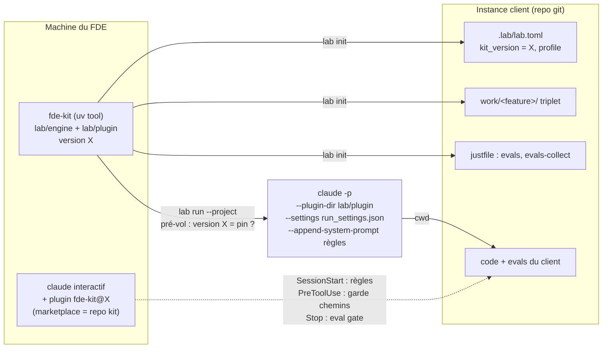

# Design — Kit FDE portable

> **Périmètre de cette version : itérations 1 « kit portable » (livrée, `v0.1.0`) et 2 « profils
> d'organisation »** — itération 1 : BHV-1 (+1b..1e), BHV-2 (+2a, 2b), INV-1, INV-7, INV-8, INV-9,
> EVAL-1, EVAL-2, EVAL-8 ; itération 2 : BHV-3 (+3a..3c), INV-2, INV-3 (volet profils), INV-5,
> EX-1, EVAL-3 (ADR-13..16, ADR-10 remplacé par ADR-15). Les itérations 3 (workflow de bout en
> bout, retours arrière, test goldfish : BHV-4..6, BHV-8) et 4 (retro, improver : BHV-7, BHV-12)
> seront conçues à leur tour, par amendement de ce document.
>
> Source : rapport `design-scout` du 2026-11-12 (références vérifiées dans la doc officielle,
> le code source de Copier/Black et des essais locaux) + 4 décisions Owner prises par QCM.

## 1. Architecture overview

Le kit devient **un seul paquet Python** (`fde-kit`) qui embarque le moteur et le plugin
Claude Code, avec **une seule version**. Le FDE l'installe chez lui (`uv tool install`) et
installe le même plugin pour ses sessions interactives (marketplace = ce repo). Une instance
client ne reçoit que des données projet. Dans un run orchestré, **le moteur fournit
explicitement** à chaque appel agent le plugin, les interdictions et les règles dures : aucun
garde-fou de run ne dépend de ce que l'instance ou la machine contiennent par ailleurs.



Flux d'un run : pré-vol (racine du kit, version CLI, version épinglée, combinaison
runner/instance) → verrou → boucle DAG existante, inchangée → chaque appel agent passe par
l'unique constructeur `claude_argv`, qui ajoute plugin + settings + règles.

## 2. Reference repositories — the foundation

### 2.1 Internal reference repos

| Repo | Team / contact | Access on day 1? | What we reuse | What we drop |
|---|---|---|---|---|
| ce repo (le kit lui-même) | FDE / Owner | ☑ | patterns I-1..I-19 ci-dessous | anti-patterns de la colonne « à ne pas reproduire » |

| # | Problème | Pattern interne (fichier:ligne) | Réutilisation | À ne pas reproduire |
|---|---|---|---|---|
| I-1 | Settings dans l'argv agent | `lab/engine/runner.py:48-84` `claude_argv`, constructeur unique hôte + sandbox ; ajouts conditionnels `:78-79` | Ajouter plugin/settings/règles ici, une seule fois ; argv inchangé quand non demandé (`tests/orchestrator/test_external_project.py:64-80`) | `lab/engine/eval_models.py:83-99` construit son propre argv (corrigé par ADR-11) |
| I-2 | Racine kit vs racine build | `orchestrate.py:81-95`, `:217`, `:748-757` | Plugin et settings résolus depuis LAB, jamais depuis PROJECT | Porter de la config via `--add-dir` (ne charge ni hooks ni denies) |
| I-3 | Interdictions | `.claude/settings.json:6-17` | `Edit(**/.approvals/**)`, `Edit(**/.runs/**)` (ancrés au cwd, corrects via `--settings`) | Entrées `Write`/`MultiEdit`/`NotebookEdit` : acceptées mais jamais appliquées |
| I-4 | Eval gate de session | `.claude/hooks/eval_gate.sh:11-12` (garde de boucle), `:25-31` (exit 2) | Devient un hook du plugin, appelé via `${CLAUDE_PLUGIN_ROOT}` | Chemins `$CLAUDE_PROJECT_DIR/.claude/hooks/…` (introuvables en instance ⇒ exit 127 non bloquant) ; `:15` sort en 0 sans `pyproject.toml` |
| I-5 | Refus de démarrer | `orchestrate.py:797-808` (pré-vol, rc 1 avant le verrou) | Même forme pour version, runner, racine | — |
| I-6 | Données TOML versionnées | `lab/models/registry.toml:11`, `lab/engine/registry.py:50-63` | `.lab/lab.toml` : `tomllib` + `schema_version` | `registry.py:55-56` : fichier absent ⇒ registre vide silencieux |
| I-7 | Forme CLI / rapport | `lab/engine/brand_guard.py:138-183`, `:53-56` | `lab init` : plan calculé d'abord, une ligne par fichier, rc 0/1 ; variable d'env comme seam de test | — |
| I-8 | Recette présente ? | `orchestrate.py:245-256` `_just_has_recipe` | Idée reprise via `just --justfile <p> --dump --dump-format json` | `just --summary` remonte aux justfiles parents ; échec de parse ⇒ faux négatif ⇒ doublon |
| I-9 | Contrat des recettes d'evals | `orchestrate.py:259-289` | Noms `evals` / `evals-collect` déjà consommés par le moteur | Recette du kit `justfile:72-74` verte sans evals : jamais comme modèle non-Python |
| I-10 | Tests de hooks | `tests/orchestrator/test_hooks.py:17-42` | Tester SessionStart (stdout) et la garde PreToolUse (exit 2) sans session live | — |
| I-11 | Shim agent | `tests/orchestrator/conftest.py:26-42`, `:131-133` (`argv.log`) | Assertions EX-5 sur l'argv | `conftest.py:29` suppose `claude -p` : ajouter une branche `--version` |
| I-12 | Source unique des règles | `work/sdlc-rework/design.md` ADR-5, `tests/sdlc_rework/test_agents_md.py:13-21` | Un seul fichier de règles, lu par le hook et par le moteur | Texte de règles copié dans des chaînes de hook ou en double dans CLAUDE.md |
| I-13 | Tests subprocess | `tests/orchestrator/test_external_project.py:28-42`, `:83-102` | `lab init` sur un repo git temporaire, assertion du jeu de fichiers EX-4 | — |
| I-14 | Imports depuis n'importe où | `lab/engine/eval_models.py:44` | Shim de point d'entrée gardant les imports plats `orchestrate.py:55-67` | Toutes les recherches de racine supposant un checkout : `orchestrate.py:73-78`, `eval_models.py:49-55`, `context_budget.py:59`, `run_report.py:25-26`, `trajectory_guard.py:115`, `approve.sh:9`, `reject.sh:11` |
| I-15 | Emplacement des agents | `context_budget.py:27-32`, prompts `orchestrate.py:377,593` | Suivent le déplacement vers `lab/plugin/` | Chemins `root/.claude/agents/` codés en dur |
| I-16 | Sandbox | `sandbox_runner.py:112-117` (montage workspace seul), `:158-163` | Chemins relatifs au cwd en mode kit (ADR-10) | — (aucun pattern pour une instance externe) |
| I-17 | Découverte des features | `.githooks/pre-commit:24-27`, `ci_checks.sh:22-25` | Scannent déjà `examples/` | — |
| I-18 | Contenu du wheel | `pyproject.toml:12-13` | `packages = ["lab"]` embarque engine, models, templates et `lab/plugin/` | Nom/description du démo (`pyproject.toml:2,4`) |
| I-19 | Versions qui doivent concorder | `tests/sdlc_rework/test_lockfile.py:14-35` | Test de cohérence version paquet = `plugin.json` = entrée marketplace | — |
| I-20 | Constantes du moteur | `orchestrate.py:91-94` (`MAX_EVAL_RETRIES`, `MAX_PARALLEL`, `MAX_CP_REJECTS`, `BUDGET_USD`) | Deviennent des lectures de la politique effective (ADR-14) | Constantes de module figées au chargement : la politique est résolue après `--project` |
| I-21 | Règle de plan qui protège le merge | `planlint.py:265-267` (CP final/merge en `mode: auto` ⇒ erreur) | Même forme pour les clés de sécurité appliquées par plan-lint (ADR-14) ; INV-5 n'a **pas** de clé | — |
| I-22 | Refus au démarrage | `orchestrate.py:229-271` `preflight()`, `:269-270` refus sandbox + instance | Accueille `sandbox_required` / `allow_force` (ADR-14) ; le refus `:269-270` disparaît (ADR-15) | — |
| I-23 | `--force` | `orchestrate.py:986-989`, `:1035` (ignore statut `approved` + erreurs de lint) | C'est cette porte que `allow_force = false` ferme | — |
| I-24 | Montage sandbox | `sandbox_runner.py:112-115` (`-v <ws>:/workspace:rw`), `:161-164` (`add_dirs` non transmis) | Ajout d'un second montage, kit en lecture seule (ADR-15) | Transmettre des chemins hôte à l'intérieur du conteneur |
| I-25 | Paramètres d'un TOML d'instance | `lab_init.py` (écrit `.lab/lab.toml`), I-6 | `[overrides]` et `[overrides.routes]` lus avec `tomllib` (ADR-13) | Une clé inconnue ignorée en silence (I-6 `registry.py:55-56`) |

### 2.2 Open source / external references

| # | Problème | Référence | Pattern emprunté | Source précise |
|---|---|---|---|---|
| E-1 | Format du plugin | Claude Code — plugins reference | `.claude-plugin/plugin.json`, `agents/`, `skills/<n>/SKILL.md`, `hooks/hooks.json`, `${CLAUDE_PLUGIN_ROOT}` ; un CLAUDE.md de plugin n'est pas chargé ; `claude plugin validate --strict` | code.claude.com/docs/en/plugins-reference |
| E-2 | Un plugin peut-il porter des denies ? | idem, #settings | **Non** : seules `agent` et `subagentStatusLine` sont prises en compte | idem |
| E-3 | Bloquer une écriture depuis un plugin | Claude Code — hooks, permissions | PreToolUse exit 2 ou `permissionDecision: "deny"` ; `"onFailure": "block"` | code.claude.com/docs/en/hooks ; /permissions |
| E-4 | Échec d'un hook | Claude Code — hooks | Exit ≠ 0/2 non bloquant ; `onFailure` sans effet sur Stop | hooks #other-exit-codes, #stop |
| E-5 | Denies via `--settings` | Claude Code — settings, permissions | `--settings` au-dessus des scopes projet/utilisateur ; deny évalué en premier ; `Edit(path)` couvre tous les outils d'édition ; `**/` ancré au cwd | code.claude.com/docs/en/settings ; /permissions |
| E-6 | Options headless | Claude Code — CLI reference, headless | `--plugin-dir` (remplace un plugin installé de même nom), `--settings`, `--append-system-prompt` ; `--bare` annoncé comme futur défaut de `-p` | code.claude.com/docs/en/cli-reference ; /headless |
| E-7 | Contexte au démarrage | Claude Code — hooks #sessionstart | stdout du hook SessionStart ajouté au contexte | hooks #sessionstart |
| E-8 | Détecter un plugin | Claude Code — plugins/loading | `claude plugin list --json` ; événement `system/init` | /plugins/loading |
| E-9 | Distribution versionnée | Claude Code — marketplace reference | `.claude-plugin/marketplace.json` à la racine, source relative, `ref` par tag | /plugins/marketplace-reference |
| E-10 | Pin exact, refus nommant les deux versions | Black (MIT) | `required-version` : « The required version X does not match the running version Y! », exit 1 | `black/__init__.py:671-681` (26.10.1) |
| E-11 | Moteur en CLI | uv tools + `[project.scripts]` | `uv tool install git+<repo>@<tag>` ; `importlib.metadata.version()` | aide locale uv 0.11.32 + essai |
| E-13 | Scaffolding idempotent sans écrasement | Copier (MIT) — pattern seul, pas de dépendance | Classement create / identical / conflict avant écriture ; `--pretend` ; fichier de réponses = version du modèle épinglée dans le projet | `copier/_main.py:531-598`, `:505-512`, `:378-385` (9.19.1) |
| E-15 | Garde-fou plancher qu'un niveau inférieur ne peut qu'affiner | AWS Organizations — service control policies | Une SCP ne donne aucun droit : elle borne ; les droits effectifs d'un compte sont l'intersection de ce que permettent toutes les couches ⇒ une couche basse ne peut que **resserrer** (pour nous : plancher ⊕ override = valeur la plus stricte, clé par clé) | docs.aws.amazon.com/organizations/latest/userguide/orgs_manage_policies_scps.html |
| E-16 | Trois niveaux nommés et cumulatifs | Kubernetes — Pod Security Standards | `privileged` / `baseline` / `restricted` : niveaux nommés, chacun plus strict que le précédent, choisis explicitement par namespace (pour nous : `solo` / `squad` / `regulated`, choix explicite à `lab init`) | kubernetes.io/docs/concepts/security/pod-security-standards/ |
| E-17 | Monter un répertoire en lecture seule dans un conteneur | Docker — bind mounts | `-v <src>:<dst>:ro` (ou `--mount type=bind,src=…,dst=…,readonly`) : le conteneur lit, n'écrit pas | docs.docker.com/engine/storage/bind-mounts/ |
| E-14 | Ajouter une recette à un justfile existant | **aucune référence** | `import` d'un `lab.just` redéfinissant `evals` casse le justfile entier (vérifié, just 1.59.0) ⇒ ADR-8 délibéré | — |

## 3. Stack

| Layer | Choice | Justified by (ref §2) |
|---|---|---|
| Runtime | Python 3.12, stdlib seule (`tomllib`, `importlib.metadata`, `json`, `subprocess`) | NG-2 spec ; patterns I-6, I-14 |
| Packaging | hatchling, `packages = ["lab"]`, paquet `fde-kit`, CLI `lab` | I-18, E-11 |
| Agent | Claude Code CLI ≥ 2.1.295 (`onFailure`), plugin `fde-kit` | E-1, E-3, E-6 |
| Scaffolding | stdlib, pattern Copier | E-13 |
| Tests | pytest + shim `claude` existant | I-10, I-11, I-13 |

## 4. ADRs — Architecture Decision Records

### ADR-1 — Un paquet, une version : moteur + plugin dans `fde-kit`
- **Status:** accepted
- **Context:** le kit doit voyager avec le FDE (OQ-1) et le run doit utiliser exactement le
  plugin de la version épinglée (INV-7). Deux artefacts versionnés séparément dériveraient.
- **Decision:** le plugin vit sous `lab/plugin/` (`.claude-plugin/plugin.json`, `agents/`,
  `skills/`, `hooks/`, `rules/`). Le wheel `fde-kit` (`packages = ["lab"]`) embarque moteur et
  plugin. Le repo est sa propre marketplace (`.claude-plugin/marketplace.json` à la racine,
  source `./lab/plugin`). Un test de cohérence impose version `pyproject.toml` = `plugin.json` =
  entrée marketplace. CLI `lab` (`[project.scripts]`) : `init`, `run` et `validate` (relais vers
  l'orchestrateur), `version`. Installation : `uv tool install git+<url-du-repo-kit>@v<x.y.z>`.
- **Anchored on:** E-1, E-9, E-11, I-18, I-19.
- **Alternatives considered:** plugin dans un repo séparé (rejeté : deux versions à synchroniser) ;
  plugin à la racine `plugin/` (rejeté : hors du wheel, il faudrait un `force-include`).
- **Consequences:** le nom de paquet top-level `lab` est générique ; acceptable dans le venv
  isolé d'un `uv tool`, à revoir si le kit devient une dépendance importée.

### ADR-2 — Runs orchestrés : le moteur fournit plugin, interdictions et règles à chaque appel
- **Status:** accepted (décision Owner : `--plugin-dir` explicite)
- **Context:** `--add-dir` ne charge ni hooks ni denies ; un plugin ne peut pas porter de denies ;
  le chargement implicite des plugins utilisateur par `-p` risque de disparaître (`--bare`).
- **Decision:** `claude_argv` (constructeur unique) ajoute, quand le moteur le demande :
  `--plugin-dir <lab/plugin>`, `--settings <lab/engine/run_settings.json>` (uniquement les deux
  denies `Edit(**/.approvals/**)` et `Edit(**/.runs/**)`, **aucun hook**), et
  `--append-system-prompt <contenu de lab/plugin/rules/hard-rules.md>`. Le moteur ne passe
  jamais `--bare`. Aucun garde-fou de run ne dépend d'un hook : l'eval gate de run reste
  `_eval_gate` du moteur (`orchestrate.py:424-459`) ; le hook Stop du plugin est un plus.
- **Anchored on:** I-1, I-2, E-5, E-6.
- **Alternatives considered:** plugin installé chez l'utilisateur + `claude plugin list --json`
  (rejeté par l'Owner : dépend du comportement implicite de `-p`) ; `--append-system-prompt-file`
  (rejeté : documenté mais absent de l'aide locale, non exercé).
- **Consequences:** BHV-2a s'interprète ainsi : « plugin absent » = `lab/plugin/` introuvable dans
  le kit installé (installation cassée) ; « version ≠ pin » = version du kit ≠ `kit_version`.
  `--plugin-dir` remplace un plugin installé de même nom : pas de double chargement.

### ADR-3 — Une seule source pour les règles dures
- **Status:** accepted (décision Owner : `plugin/` source unique)
- **Context:** ADR-5 de sdlc-rework interdit une seconde source de vérité ; l'instance ne doit
  contenir aucun fichier de règles (INV-8).
- **Decision:** la méthode portable (les 3 artefacts, règles dures, vocabulaire) va dans
  `lab/plugin/rules/hard-rules.md`. Elle est injectée par le hook SessionStart du plugin
  (sessions interactives, BHV-2b) et par `--append-system-prompt` (runs, ADR-2). Le
  `CLAUDE.md` du kit ne garde que ce qui est propre au repo du kit (stack, langue, brand guard,
  développement du kit) et pointe vers le fichier de règles. Le `.claude/` du kit disparaît :
  on développe le kit avec `--plugin-dir lab/plugin`. Les agents `.md` sont déplacés sans
  modification de contenu (forme) ; toute modification de contenu suit la boucle
  `lab/models/EVOLUTION.md`. La status line (`.claude/statusline.py`) part dans
  `lab/plugin/statusline.py` : un plugin ne peut pas définir la status line principale (E-2), le
  FDE la câble une fois dans ses réglages utilisateur (OQ-9).
- **Anchored on:** I-12, E-7.
- **Alternatives considered:** garder les règles dans CLAUDE.md et les faire lire par le plugin
  (rejeté par l'Owner : le kit ne se développerait pas avec son propre outillage).
- **Consequences:** `tests/sdlc_rework/test_agents_md.py:21` compare la taille d'AGENTS.md à
  celle de CLAUDE.md : la comparaison se fait désormais au fichier de règles (le contrat EVAL-5
  de sdlc-rework, « pointe vers CLAUDE.md sans dupliquer de règle », est inchangé). Le canal de
  livraison des règles change ⇒ ré-évaluation de la chaîne de commandement (ADR-11).

### ADR-4 — Garde-fous interactifs portés par les hooks du plugin
- **Status:** accepted
- **Context:** en session interactive, le plugin ne peut pas déclarer de denies (E-2) et les
  hooks actuels échouent ouverts en instance (I-4).
- **Decision:** `lab/plugin/hooks/hooks.json` déclare : `PreToolUse` sur
  `Edit|Write|MultiEdit|NotebookEdit` → `guard_paths.sh` (exit 2 si `tool_input.file_path` est
  sous `.approvals/` ou `.runs/`, `"onFailure": "block"`) ; `SessionStart` → affiche les règles ;
  `Stop`/`SubagentStop` → `eval_gate.sh` ; `PostToolUse` → lint. Tous référencés via
  `"${CLAUDE_PLUGIN_ROOT}"/hooks/…`. `eval_gate.sh` se déclenche aussi quand `.lab/lab.toml`
  existe (plus de sortie silencieuse sans `pyproject.toml`). Les entrées de deny inertes
  disparaissent avec le `.claude/settings.json` du kit.
- **Anchored on:** E-3, E-4, E-7, I-4, I-10.
- **Alternatives considered:** aucune côté plugin (E-2).
- **Consequences:** une écriture par sous-processus (script Python lancé via Bash) n'est pas
  bloquée : limite connue du modèle de confiance (README), la sandbox reste la vraie frontière.

### ADR-5 — Le kit retrouve sa racine, qu'il soit cloné ou installé
- **Status:** accepted
- **Context:** installé par `uv tool`, `_repo_root()` remonte jusqu'à `site-packages` et le
  registre se charge vide sans erreur (constat design-scout).
- **Decision:** racine du kit = `LAB_ROOT` si défini (seam de test conservé), sinon
  `Path(__file__).resolve().parents[2]` si elle contient le marqueur `lab/models/registry.toml`
  (vrai dans un checkout comme dans `site-packages`), sinon erreur rc 1. Toutes les recherches
  listées en I-14 passent par une fonction unique. Version du kit lue via
  `importlib.metadata.version("fde-kit")`, avec repli sur `pyproject.toml` dans un checkout.
- **Anchored on:** I-14, E-11.
- **Consequences:** `load_registry` garde son repli « registre vide » pour le seam de test
  uniquement.

### ADR-6 — Pré-vol fail-closed : versions et combinaisons interdites
- **Status:** accepted
- **Context:** BHV-2a, INV-7 ; une CLI trop ancienne ignore `onFailure`.
- **Decision:** avant le verrou, `lab run --project <instance>` vérifie dans l'ordre : racine du
  kit résolue (ADR-5) ; `lab/plugin/` présent ; `.lab/lab.toml` présent et `kit_version` =
  version du kit, sinon rc 1 avec le message de la spec EX-5 « plugin X ≠ pinned kit Y » ; `claude --version` ≥ 2.1.295 ;
  combinaison runner/instance autorisée (ADR-10). En mode kit (sans `--project`), seules les
  vérifications de racine, de plugin et de CLI s'appliquent.
- **Anchored on:** E-10 (forme du message), I-5.
- **Alternatives considered:** version minimale seulement (pre-commit, `minimum_pre_commit_version`)
  — rejeté : INV-7 demande un pin exact.

### ADR-7 — `lab init` : plan d'abord, jamais d'écrasement
- **Status:** accepted
- **Decision:** `lab init <project> --profile <p> [--dry-run]` (`--profile` obligatoire : absent ⇒ rc 1
  listant `solo`, `squad`, `regulated` — le niveau de contrôle est toujours un choix explicite, OQ-11) calcule le plan complet, classe
  chaque fichier (`create` / `identical` / `skip` — jamais `overwrite`), l'affiche une ligne par
  fichier, puis l'applique sauf en `--dry-run`. Fichiers : `.lab/lab.toml`
  (`schema_version = 1`, `kit_version`, `profile`), `work/README.md` et `work/_templates/{spec,design,tasks}.template.md` (jamais nommés
  `spec.md`/`design.md`/`tasks.md` : le pre-commit et `ci_checks.sh` prendraient `work/` pour une
  feature et plan-lint rejette le modèle brut — OQ-10), et
  les recettes du justfile (ADR-8). Rien sous `.claude/`, pas de `CLAUDE.md`/`AGENTS.md`, pas
  de workflow CI (INV-8). Second lancement : tout est `identical` ⇒ « 0 changement ».
  Profils acceptés en itération 1 : `solo`, `squad`, `regulated` (valeur seulement enregistrée ;
  son effet arrive avec l'itération 2).
- **Anchored on:** E-13, I-6, I-7, I-13.

### ADR-8 — Recettes d'evals dans un justfile existant (sans référence — délibéré)
- **Status:** accepted
- **Context:** E-14 ; BHV-1b, BHV-1e.
- **Decision:** justfile absent ⇒ créé depuis un modèle. Justfile présent ⇒ lu avec
  `just --justfile <project>/justfile --dump --dump-format json` (fichier explicite : pas de
  remontée vers un justfile parent) ; erreur de parse ⇒ rc 1 sans rien écrire ; recette
  présente ⇒ conservée telle quelle ; recette absente ⇒ ajoutée **en fin de fichier**, puis
  nouvelle lecture ; en cas d'échec, les octets d'origine sont restaurés. Modèles : instance
  Python (`pyproject.toml` présent) ⇒ `uv run pytest -m eval` (rc 5 ⇒ message, rc 0 ; l'anti-gate-vide
  du moteur reste l'autorité) ; sinon ⇒ recettes qui échouent fermées : « no evals configured —
  define `evals` and `evals-collect` », rc 1.
- **Alternatives considered:** `import 'lab.just'` (rejeté : redéfinition ⇒ justfile cassé, vérifié).

### ADR-9 — Les exemples sont des instances autonomes
- **Status:** accepted (décision Owner)
- **Decision:** `examples/devis/` (features `devis-pose`, `export-devis`) et `examples/booking/`
  (`salle-booking`), chacun avec son `pyproject.toml`, son `uv.lock`, son `.lab/lab.toml` (profil `squad`, OQ-11) et son
  justfile **produits par `lab init`**, ses `work/`, `src/`, `tests/` et ses docs produit
  (`docs/export-notes.md`, `docs/export-usage.md` partent dans `examples/devis/docs/`). Pilotés par
  `lab run --project examples/<x>`. Les chemins `files_touched`/`verify` des triplets restent
  valides, relatifs à la racine de l'exemple. Le kit garde `work/sdlc-rework` et `work/fde-kit`.
  Le `pyproject.toml` du kit devient `fde-kit` (nouveau `uv.lock` dans le même commit). `gate-ci`
  boucle sur les exemples (`just examples-gate` : `uv sync --locked` + `just evals` par exemple).
  Valeurs par défaut retenues sans QCM :
  - `evals/golden/devis-calc` reste une fixture du kit (évaluation des modèles) ; son test
    d'intégrité lit l'implémentation de référence dans `examples/devis/src/devis/calc.py`.
  - `brand_guard` scanne `examples/` (livré avec le kit, doit rester générique) ; seuls les
    `assets/` restent exclus. `.gitignore` passe de `work/**/assets/` à `**/work/**/assets/`.
  - Les docs du kit qui citent les exemples (tutoriel, format de commit, etc.) gardent leurs
    exemples et pointent vers `examples/` ; pas de réécriture générique.
- **Anchored on:** I-17, I-18, I-13 ; dogfooding de `lab init` et de `--project`.
- **Consequences:** `content_guard` voit les fichiers déplacés comme nouveaux : le commit de
  migration est un déplacement pur (`git mv`, aucune modification de contenu), relu au checkpoint.

### ADR-10 — Sandbox en itération 1 : mode kit conservé, instance externe refusée
- **Status:** superseded by ADR-15 (itération 2) — accepted (décision Owner) pour l'itération 1
- **Context:** le conteneur ne monte que le répertoire de travail, avec un home vide (I-16).
- **Decision:** en mode kit, le moteur passe plugin et settings en **chemins relatifs au cwd**
  (`lab/plugin`, `lab/engine/run_settings.json`), valides sur l'hôte comme dans `/workspace` :
  la sandbox du kit continue de fonctionner. `LAB_RUNNER=sandbox` avec `--project` ⇒ pré-vol
  rc 1 : « sandbox + external instance not supported before iteration 2 ». INV-1 est tenu par
  le refus. Le support (montage en lecture seule du kit) arrive avec l'itération 2, dont le
  profil `regulated` exige la sandbox.

### ADR-11 — La gouvernance des modèles mesure le contexte de production
- **Status:** accepted
- **Context:** `eval_models.py:83-99,132-148` construit son propre argv, sans règles ni agents :
  la couche chaîne de commandement (éliminatoire) ne teste pas le canal de livraison des règles,
  qui change avec ADR-2/ADR-3.
- **Decision:** `eval_models.py` construit ses appels via `claude_argv` avec les mêmes options
  qu'un run (ADR-2). Avant la première utilisation réelle du kit sur une mission, une campagne
  live des couches behavioral + chain est exécutée et relue (checkpoint humain, facturé).
- **Anchored on:** `lab/models/EVOLUTION.md` (boucle evals → scaffolding), I-1.

### ADR-12 — Banc d'évaluation des modèles : spike promptfoo (itération multi-outils)
- **Status:** proposed — spike à mener dans l'itération multi-outils (BHV-11), décision sur preuve
- **Context:** la campagne du 2026-11-12 a montré trois défauts du banc maison (`eval_models.py`) :
  un appel en erreur (quota, API) compté comme un échec du modèle — y compris 3 fausses violations
  de chaîne de commandement —, un seul essai par tâche, et pas de distinction erreur/échec. BHV-11
  exigera en plus un runner par outil (Copilot, opencode, Codex CLI).
- **Decision:** spike : ré-exprimer les 14 cas existants dans promptfoo — nos fixtures et nos
  fonctions `check()` restent la source unique, branchées en provider et assertions personnalisés —
  puis rejouer la même campagne. Adoption si promptfoo est au moins aussi strict (même verdicts,
  chaîne éliminatoire conservée) et moins coûteux à maintenir ; sinon, correction du banc maison.
  La logique propre au lab (éliminatoire, recommandation par rôle, séparation des tâches,
  promotion `[roles]`) reste un post-traitement du lab dans les deux cas.
- **Anchored on:** promptfoo (outil open source d'évaluation et de red-teaming de LLM : matrice
  fournisseurs × cas, répétitions, cache, distinction erreur/échec, providers personnalisés) —
  référence précise (version, licence, fichiers) à collecter par design-scout avant le spike.
- **Alternatives considered:** garder et corriger le banc maison (option de repli du spike).
- **Consequences:** chaîne d'outils Node.js en plus du stack Python (verrouillage des versions à
  prévoir, comme `uv.lock`) ; télémétrie et partage de résultats à désactiver explicitement pour les
  missions client.

### ADR-13 — Politique effective : plancher monotone ⊕ overrides, clé par clé
- **Status:** accepted
- **Context:** BHV-3 / INV-2 : trois profils nommés, une instance peut durcir, jamais assouplir ; les
  clés libres (performance, coût) restent réglables.
- **Decision:** les profils sont des **données** : `lab/engine/policy_profiles.toml`
  (`schema_version = 1`), une entrée par clé avec `kind = "safety" | "free"`, la direction stricte
  (`strict = "true" | "false" | "up" | "down"`) et la valeur par profil — la table de BHV-3 telle
  quelle. Module `lab/engine/policy.py` : `effective_policy(lab_toml) -> {key: (value, origin)}` où
  `origin ∈ {floor, override, override (free key)}`. Clé de sécurité : override accepté seulement
  s'il est au moins aussi strict que le plancher, sinon rc 1 avec le message d'EX-1
  (`<key>=<v> is looser than floor '<profile>' (<floor>)`, BHV-3a). Clé inconnue (y compris
  sous `[overrides.routes]`) : rc 1 (BHV-3b). `goldfish_min_score` est déclarée, « non déclarée »
  par défaut, sans effet avant l'itération 3. Commande `lab policy [--project p]` : une ligne par
  clé, valeur et origine. **Aucune clé ne touche au merge** (INV-5) : il n'y a pas de clé à
  durcir ou assouplir, la règle reste dans plan-lint (I-21).
- **Routes (décision Owner) :** `[overrides.routes]` est réservé dès l'itération 2 : `R1`..`R7`
  connues, valeur `auto | proposal | human` ; `auto` sur R2, R3, R4 ou R5 ⇒ rc 1 (BHV-3c, INV-3) ;
  une route inconnue ⇒ rc 1. Les modes sont validés et affichés par `lab policy` mais **appliqués
  à partir de l'itération 3** (BHV-5), ce que l'affichage dit.
- **Anchored on:** E-15 (intersection : une couche basse ne peut que resserrer), E-16 (niveaux nommés
  cumulatifs, choix explicite), I-6 / I-25 (TOML + `schema_version`, jamais de clé ignorée).

### ADR-14 — Chaque clé a un seul point d'application, mécanique
- **Status:** accepted
- **Decision:** la politique effective est résolue **une fois**, au démarrage (après `--project`),
  et chaque clé est appliquée là où BHV-3 l'indique, jamais deux fois :
  - **plan-lint** (erreur) : `auto_checkpoints_allowed = false` ⇒ tout CP `mode: auto` ;
    `min_reviewers` ⇒ un CP dont `reviewers` est inférieur ; `max_tasks_between_checkpoints` ⇒
    plus de N tâches entre deux CP sur un chemin du graphe (I-21) ;
  - **pré-vol** (rc 1, avant le verrou, I-22) : `sandbox_required = true` ⇒ `LAB_RUNNER=sandbox`
    exigé ; `allow_force = false` ⇒ `--force` refusé (I-23) ;
  - **moteur** : `max_task_attempts`, `max_parallel`, `max_cp_rejects`, `budget_usd` remplacent les
    constantes de module (I-20). `LAB_BUDGET_USD` reste un réglage opérateur de cette clé libre
    (prioritaire s'il est posé) ; la politique fournit la valeur par défaut.
  plan-lint reçoit la politique effective en paramètre (fonction pure, comme le registre) : sans
  instance (tests, `lab validate` hors projet), le profil `squad` documenté sert de valeur d'essai,
  jamais pour un run réel (ADR-16).
- **Anchored on:** I-20, I-21, I-22, I-23 (formes existantes de règle, de refus et de lecture).

### ADR-15 — Sandbox pour une instance externe : kit monté en lecture seule
- **Status:** accepted (décision Owner) — remplace ADR-10
- **Decision:** avec `--project`, le runner sandbox monte **deux** répertoires : l'instance en
  `/workspace` (lecture-écriture, cwd de l'agent) et la racine du kit en `/kit` **en lecture
  seule** (E-17). Le moteur passe alors `--plugin-dir /kit/lab/plugin`,
  `--settings /kit/lab/engine/run_settings.json`, et traduit les `add_dirs` qui pointent dans le
  kit vers `/kit/…` ; tout autre chemin hôte reste refusé (I-24). Le refus d'ADR-10 disparaît du
  pré-vol. Mode kit inchangé (chemins relatifs, ADR-10). Les tests d'argv restent sans Docker ;
  un essai Docker réel est un contrôle de checkpoint, pas un test du gate.
- **Anchored on:** I-16, I-24, E-17.

### ADR-16 — Le kit est une instance de lui-même
- **Status:** accepted (décision Owner)
- **Decision:** le repo du kit reçoit son propre `.lab/lab.toml` (`profile = "squad"`,
  `kit_version` = version du kit) ; le mode kit lit la politique comme une instance. Un run réel
  sans `.lab/lab.toml` ⇒ pré-vol rc 1 (« le niveau de contrôle est toujours un choix explicite »,
  OQ-11) — y compris en mode kit. Les bacs à sable de test écrivent leur `.lab/lab.toml`.
- **Anchored on:** ADR-7 (le même fichier, écrit par `lab init`), ADR-9 (exemples = instances).

## 5. Contracts & data

- **`.lab/lab.toml`** (instance) :
  ```toml
  schema_version = 1
  kit_version = "0.1.0"   # pin exact (INV-7), comparé à la version du kit installé
  profile = "squad"       # solo | squad | regulated — plancher (ADR-13)

  [overrides]             # optionnel : durcir une clé de sécurité, régler une clé libre
  min_reviewers = 2
  max_parallel = 4

  [overrides.routes]      # optionnel : R1..R7 = auto | proposal | human (appliqué en itération 3)
  R6 = "human"
  ```
- **`lab/engine/policy_profiles.toml`** (kit, ADR-13) : une table par clé — `kind`, `strict`,
  `solo`, `squad`, `regulated` — reproduisant la table de BHV-3.
- **`lab/engine/run_settings.json`** : `{"permissions": {"deny": ["Edit(**/.approvals/**)", "Edit(**/.runs/**)"]}}` — aucun hook.
- **`lab/plugin/.claude-plugin/plugin.json`** : `name = "fde-kit"`, `version` = version du paquet.
- **`.claude-plugin/marketplace.json`** (racine du repo) : une entrée `fde-kit`, source `./lab/plugin`.
- **CLI** : `lab init <project> --profile <solo|squad|regulated> [--dry-run]` ; `lab run <feature> [--project p] [options d'orchestrate]` ;
  `lab validate <feature> [--project p]` ; `lab policy [--project p]` ; `lab version`.

## 6. Design System & Global Ready

Sans objet (outillage en ligne de commande, pas d'interface).

## 7. Observability & rollout

- Journal de run inchangé en itération 1. Itération 2 : l'événement `run_start` porte le profil et
  la politique effective (clé, valeur, origine) — un run se relit avec ses réglages.
- **Rollout** : tag `v0.1.0` du kit ; vérification sur les deux exemples (`lab init` puis
  `lab run --project examples/<x> --dry-run`) avant la campagne live d'ADR-11 ; aucune mission
  réelle avant cette campagne.
- **Rollout itération 2** : version du kit `0.2.0` (les exemples ré-épinglent explicitement, INV-7) ;
  `lab policy` vérifié sur les deux exemples et sur le kit ; un run `regulated` sur une instance
  externe en sandbox Docker réelle avant le tag.

## 8. Risks

| Risk | Probability | Impact | Mitigation |
|---|---|---|---|
| `--bare` devient le défaut de `-p` et ignore les hooks du plugin | M | M | Aucun garde-fou de run ne dépend d'un hook (ADR-2) ; denies via `--settings` (l'aide locale indique que `--settings` s'applique en `--bare`, à confirmer par la campagne live) |
| Le changement de canal des règles dégrade la chaîne de commandement | M | H | Campagne live ADR-11 avant toute mission ; un échec chain est éliminatoire |
| Migration `examples/` : régression silencieuse (content_guard aveugle aux fichiers déplacés) | M | M | `git mv` pur, `just gate-ci` + `examples-gate` verts, relu au checkpoint |
| Écriture sous `.approvals/` par sous-processus | L | H | Modèle de confiance existant : approbations signées (HMAC) + sandbox comme frontière dure |
| Divergence version paquet / plugin / marketplace | L | M | Test de cohérence (I-19) dans le gate |
| CLI Claude Code trop ancienne chez le FDE | M | M | Pré-vol `claude --version` ≥ 2.1.295 (ADR-6) |
| `.lab/lab.toml` exigé partout (ADR-16) casse les bacs à sable de test et les runs existants | H | M | Les fixtures écrivent le fichier ; message de pré-vol qui nomme la commande `lab init … --profile` |
| Docker indisponible là où l'on développe : ADR-15 non vérifié en réel | M | H | Tests d'argv sans Docker dans le gate ; essai Docker réel exigé au checkpoint avant le tag |
| Un override de route accepté en itération 2 mais sans effet trompe l'Owner | M | L | `lab policy` affiche « appliqué à partir de l'itération 3 » à côté de chaque route |

## 9. Changelog

| Version | Date | Author | Change |
|---|---|---|---|
| 0.1.0 | 2026-11-12 | Owner + design-scout | Design de l'itération 1 (kit portable) : ADR-1..11, dont 4 décisions Owner par QCM (plugin explicite en run, `lab/plugin` source unique, exemples en instances autonomes, sandbox + instance refusée) |
| 0.2.0 | 2026-11-12 | FDE | Design validé : ADR-1..11 acceptés, emplacement `lab/plugin/` confirmé |
| 0.3.0 | 2026-11-12 | FDE | Trous relevés par le planner tranchés : status line dans le plugin câblée par le FDE (OQ-9, ADR-3), modèles `work/_templates/*.template.md` (OQ-10, ADR-7), `--profile` obligatoire et exemples en `squad` (OQ-11, ADR-7/9) ; message d'ADR-6 aligné sur EX-5 |
| 0.4.0 | 2026-11-12 | FDE | ADR-12 (proposed) : spike promptfoo pour le banc d'évaluation, à mener dans l'itération multi-outils ; pointeur spec 0.6.0 |
| 0.5.0 | 2026-11-12 | Owner | Itération 2 (profils) : ADR-13 politique effective (plancher monotone ⊕ overrides, profils en données), ADR-14 un point d'application par clé, ADR-15 sandbox d'instance externe (kit monté en lecture seule, remplace ADR-10), ADR-16 le kit est une instance de lui-même. 3 décisions Owner par QCM : routes réservées dès l'itération 2, sandbox externe livrée, `.lab/lab.toml` du kit explicite |
