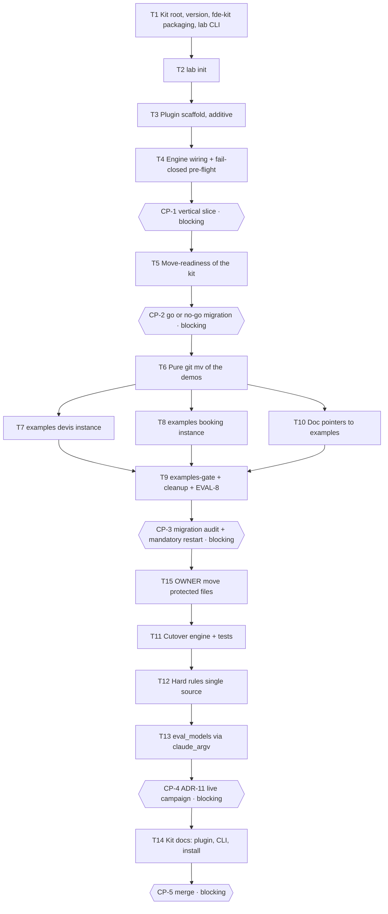

# Tasks — Portable FDE kit, iteration 1 ("kit portable")

> **Scope = design.md 0.2.0, iteration 1 only:** BHV-1 (+1b..1e), BHV-2 (+2a, 2b), INV-1, INV-7,
> INV-8, INV-9, EVAL-1, EVAL-2, EVAL-8, implemented per ADR-1..11. BHV-3..8, INV-2..6, INV-10..12
> and EVAL-3..7/9/10 belong to iterations 2-4 (designed later, by amendment of design.md):
> plan-lint warns that those EVALs are carried by no task — **expected**.
>
> Orchestration rules (lab/templates/tasks.md): sequence = `depends_on`; parallel = same
> `parallel_group` AND disjoint `files_touched`; checkpoints pause the run (`blocking` = human,
> `auto` = evals green + reviewer PASS, chosen by the Owner at approval; merge always blocking);
> every task references its spec IDs; a failed/blocked task only skips its own sub-tree;
> plan-lint (`python3 lab/engine/orchestrate.py work/fde-kit --validate`) green before approval.

## Self-hosting protocol (read before approving)

This plan is meant to be executed by `lab/engine/orchestrate.py` **on this very repo**. A running
orchestrator keeps the code it loaded at start: agent prompts (`orchestrate.py:377,593`) and argv
come from that in-memory code, and in kit mode the agents also rely on `.claude/settings.json`
(denies + hooks), `.claude/agents/*.md` and CLAUDE.md (hard rules). Hence:

1. **Additive first.** T1–T4 only ADD (kit root/version, `lab init`, `lab/plugin/`,
   `lab/engine/run_settings.json`, the rules file, the engine wiring). `.claude/` and CLAUDE.md
   are untouched until T11/T12, so a pre-T4 engine and a post-T4 engine (which passes
   `--plugin-dir`, `--settings`, `--append-system-prompt` itself) are both consistent with the
   tree at every commit.
2. **Per-call agent-file resolution.** T4 resolves the agent `.md` at each call
   (`lab/plugin/agents/` first, legacy `.claude/agents/` as a transitional fallback that T11
   deletes), so the engine in memory survives the T11 move.
3. **Restart before anything destructive.** CP-3 (blocking) requires stopping and restarting the
   orchestrator before approving: T11 (deletes `.claude/`) and T12 (moves the hard rules out of
   CLAUDE.md) must only ever run under a post-T4 engine. A restart is idempotent:
   `.runs/state.json` resumes every done node and the pending CP's review is re-generated by the
   new engine before the approval is honored. A restart at CP-1 is recommended (the rest of the
   plan then dogfoods ADR-2 in kit mode); CP-3 is the hard gate.
4. **Pure move, green kit.** The examples migration (T6) is a rename-only commit; T1 (kit
   packaging no longer depends on `src/devis`) and T5 (kit `testpaths`, golden reference lookup)
   keep the kit's `just evals` — which the engine runs after every task — green across the move.

Net effect: no implementer or reviewer is ever pointed at a missing agent file, or runs without
its denies or the hard rules.

## Plan-level open questions (numbered after spec OQ-1..8) — all resolved 2026-11-12, integrated in design 0.3.0

- **OQ-9** — *Status line after `.claude/` disappears (ADR-3).* `.claude/statusline.py` is wired by
  `.claude/settings.json` `statusLine`; a plugin cannot declare the main status line (design E-2:
  plugin settings honor only `agent` and `subagentStatusLine`). Options: (a) move it to
  `lab/plugin/statusline.py` (shipped in the wheel), wired once in the FDE's user settings and
  documented by T14 — **planner default**; (b) keep a kit `.claude/settings.json` holding only
  `statusLine` (contradicts ADR-3 "le `.claude/` du kit disparaît"); (c) drop it and its test.
  Impacts T11, T14. → *(résolue : option (a), design ADR-3)*
- **OQ-10** — *Layout of the triplet templates `lab init` writes under `work/`* (BHV-1 "work/ avec
  les templates du triplet", ADR-7 "README + templates" — no layout given). Verified constraint:
  they cannot be named `spec.md` / `design.md` / `tasks.md` — `.githooks/pre-commit` and
  `lab/engine/ci_checks.sh` treat any directory under `work/` or `examples/` holding one as a
  feature, and plan-lint rejects the raw template (`lab/templates/tasks.md` → rc 1, 6 errors), so
  the T7/T8 commits would be refused. **Planner default:** `work/README.md` +
  `work/_templates/{spec,design,tasks}.template.md`. Impacts T2, T7, T8. → *(résolue : défaut retenu, design ADR-7)*
- **OQ-11** — *`--profile` on `lab init`.* Spec BHV-1's signature makes it mandatory
  (`lab init <project> --profile 
`); design §5 shows it optional (`[--profile p]`) with no
  default. And which profile do the two examples pin (ADR-9: their `.lab/lab.toml` is produced by
  `lab init`)? **Planner default:** required (rc 1 listing `solo|squad|regulated` when absent — no
  invented default); examples pinned with `squad` (EX-4's profile; no effect before iteration 2).
  Impacts T2, T7, T8. → *(résolue : obligatoire, exemples en `squad`, design ADR-7/ADR-9)*

**Observations** (resolved in the plan; overrule at approval if needed):
- **O-1** — Pin-mismatch message: spec EX-5 literal `rc 1 — plugin 0.3.0 ≠ pinned kit 0.4.0` vs
  ADR-6 « kit X ≠ pinned Y ». T4 emits the spec literal (observable output = business contract;
  both name the two versions, E-10 form).
- **O-2** — Gate weakness, mitigated here: until T6 moves them out, the demo suites already carry
  `test_eval_1_*` / `test_eval_2_*` node-ids, so the engine's namespace-blind EVAL coverage check
  (`eval_covers`) would accept T2–T4 with no fde-kit eval at all. Each EVAL-bearing `verify`
  therefore names its own module (T2/T3 with `-m eval`: rc 4/5 if missing or empty).
- **O-3** — T1 performs the kit `pyproject.toml` → `fde-kit` switch that ADR-9 lists with the
  migration — earlier on purpose (ADR-1's CLI and ADR-5's `importlib.metadata.version("fde-kit")`
  need it, and it lets T6 be a pure move with a green kit). Same rule kept: `uv lock` in the same
  task.
- **O-4** — Two transitional bits make the self-hosting and the pure move safe, each removed and
  asserted gone later: T4's legacy `.claude/agents` resolver branch (removed by T11), T5's legacy
  `src/devis/calc.py` golden lookup (removed by T9).
- **O-5** — The rules copied verbatim by T3 still cite kit paths (`just check-content`,
  `lab/engine/content_guard.py`) that do not exist in an instance; any portability rewording is a
  content change → `lab/models/EVOLUTION.md` loop after CP-4, not this plan.
- **O-6** — After T11, an interactive session in the kit repo has no guardrails unless started
  with `claude --plugin-dir lab/plugin` (ADR-3), and `/commit` becomes the plugin's skill. Tell
  the team before merging.

## Coverage (iteration-1 scope)

| Spec ID | Tasks | Eval |
|---|---|---|
| BHV-1, BHV-1b, BHV-1c, BHV-1d, BHV-1e | T2 (dogfooded on the examples by T7, T8) | EVAL-1 |
| BHV-2 | T3, T4, T11, T13 | EVAL-2 |
| BHV-2a | T4 | EVAL-2 |
| BHV-2b | T3, T12 | EVAL-2 (+ CP-4 live check) |
| INV-1 | T3, T4, T11, T12 | EVAL-2 (+ CP-4 live check) |
| INV-7 | T1, T2, T4, T7, T8 | EVAL-1, EVAL-2, EVAL-8 (example pins) |
| INV-8 | T2 | EVAL-1 |
| INV-9 | T5, T6, T7, T8, T9, T10 | EVAL-8 |

ADRs: ADR-1 T1/T3 · ADR-2 T3/T4 · ADR-3 T3/T11/T12 · ADR-4 T3/T11 · ADR-5 T1 · ADR-6 T4 ·
ADR-7 T2 · ADR-8 T2 · ADR-9 T5–T10 · ADR-10 T4 · ADR-11 T13 + CP-4.

## Execution graph

Parallelism is deliberately narrow: every task's eval gate runs the kit-wide `just evals` on the
shared working tree, so two tasks that both add kit evals (test-first, hence red for a while)
would fail each other's gate. Only T7 ∥ T8 ∥ T10 run together: the examples are outside the kit's
test collection (T5) and T10's test is not an eval.

## Tasks

### T1 — Kit root, kit version and `fde-kit` packaging with the `lab` CLI
- **agent:** implementer
- **depends_on:** — *(entry point)*
- **parallel_group:** A
- **implements:** [INV-7]
- **anchored_on:** ADR-5, ADR-1 (packaging + CLI), I-14, I-18, I-6, E-11
- **files_touched:** `lab/engine/kit.py`, `lab/engine/cli.py`, `lab/engine/orchestrate.py`, `lab/engine/eval_models.py`, `lab/engine/context_budget.py`, `lab/engine/run_report.py`, `lab/engine/trajectory_guard.py`, `lab/engine/approve.sh`, `lab/engine/reject.sh`, `pyproject.toml`, `uv.lock`, `tests/fde_kit/__init__.py`, `tests/fde_kit/test_kit_root.py`, `tests/orchestrator/test_models.py`
- **prompt:**
  > Implement design.md ADR-5 in support of spec INV-7. Add `lab/engine/kit.py`: the ONE function
  > resolving the kit root — `LAB_ROOT` if set (test seam kept), else
  > `Path(__file__).resolve().parents[2]` if it holds the marker `lab/models/registry.toml`, else rc 1
  > with an explicit message — and the kit version (`importlib.metadata.version("fde-kit")`, fallback
  > to `pyproject.toml` in a checkout). Route every root lookup listed in design I-14 through it:
  > orchestrate.py:73-78, eval_models.py:49-55, context_budget.py:59, run_report.py:25-26,
  > trajectory_guard.py:115, approve.sh:9, reject.sh:11 (the two shell scripts must also work from an
  > installed kit, not only from a git checkout). Rewrite the walk-up assertions of
  > tests/orchestrator/test_models.py (`test_repo_root_walks_up_to_nearest_pyproject`,
  > `test_live_modules_resolve_root_to_the_repo`) to the ADR-5 semantics.
  > Packaging per ADR-1 / ADR-9, done here on purpose (the CLI and the version lookup need it, and it
  > decouples the kit install from `src/devis` before the T6 move): `pyproject.toml` name `fde-kit`,
  > generic description, `packages = ["lab"]`, `[project.scripts] lab = …` targeting
  > `lab/engine/cli.py` through an entry-point shim that keeps the engine's flat imports (I-14,
  > `eval_models.py:44` pattern). Keep `version = "0.1.0"` and keep `pythonpath = ["src"]` (the demo
  > tests stay under tests/ until T6). Run `uv lock` in this task (CLAUDE.md: a changed dependency
  > set ships with its lockfile).
  > `lab/engine/cli.py`: subcommands `version`, `run` and `validate` (pure relays to orchestrate.py,
  > every argument passed through — design §5); `init` arrives in T2. Create
  > `tests/fde_kit/__init__.py`. Write the tests BEFORE the code. Do not touch `.claude/`, CLAUDE.md,
  > `src/`, `work/`.
- **done_when:** `uv run lab version` prints the pyproject version from a checkout; root resolution covered for LAB_ROOT / marker / missing marker (rc 1); `uv lock --check` green; orchestrator and sdlc_rework suites green
- **verify:** `uv run pytest -q tests/fde_kit/test_kit_root.py tests/orchestrator tests/sdlc_rework`
- **status:** ☐ pending → ☐ running → ☐ done

### T2 — `lab init`: plan first, never overwrite, no agent tooling in the instance
- **agent:** implementer
- **depends_on:** [T1]
- **parallel_group:** B
- **implements:** [BHV-1, BHV-1b, BHV-1c, BHV-1d, BHV-1e, INV-7, INV-8, EVAL-1]
- **anchored_on:** ADR-7, ADR-8, E-13, E-14, I-6, I-7, I-8, I-9, I-13
- **files_touched:** `lab/engine/lab_init.py`, `lab/engine/cli.py`, `lab/templates/instance`, `tests/fde_kit/test_eval_1_init.py`
- **prompt:**
  > Implement `lab init <project> --profile 
 [--dry-run]` per spec BHV-1 (+1b, 1c, 1d, 1e), INV-7,
  > INV-8, EX-4 and design ADR-7 / ADR-8 (Copier pattern E-13, no dependency). Compute the whole plan
  > first, classify each file `create` / `identical` / `skip` (never `overwrite`), print one line per
  > file, then apply unless `--dry-run`; a second run prints "0 changement". Write ONLY `.lab/lab.toml`
  > (`schema_version = 1`, `kit_version` = T1's kit version, `profile` ∈ solo|squad|regulated —
  > recorded only in iteration 1; schema in design §5), `work/` (README + triplet templates taken from
  > `lab/templates/`) and the `evals` / `evals-collect` justfile recipes. Nothing under `.claude/`, no
  > CLAUDE.md / AGENTS.md, no CI workflow (INV-8).
  > Justfile per ADR-8: absent ⇒ created from a model under `lab/templates/instance/`; present ⇒ read
  > with `just --justfile <project>/justfile --dump --dump-format json` (parse error ⇒ rc 1, nothing
  > written; an existing recipe is kept byte for byte, BHV-1e; a missing recipe is appended at the end,
  > the file re-read, original bytes restored on failure). Models: Python instance (`pyproject.toml`
  > present) ⇒ `uv run pytest -m eval` (rc 5 ⇒ message + rc 0) plus a collect recipe; otherwise both
  > recipes fail closed, rc 1, "no evals configured — define `evals` and `evals-collect`" (BHV-1b;
  > never use the kit's own `justfile:72-74` recipe as a model).
  > Template layout under `work/` per OQ-10 (planner default `work/README.md` +
  > `work/_templates/{spec,design,tasks}.template.md`): the files MUST NOT be named `spec.md`,
  > `design.md` or `tasks.md` (pre-commit and ci_checks would treat the dir as a feature and plan-lint
  > rejects the raw template). `--profile` handling per OQ-11 (planner default: required, rc 1 listing
  > the three profiles when absent).
  > Expose a reader for `.lab/lab.toml` (tomllib, `schema_version` checked, missing file ⇒ explicit
  > error — not the silent-empty pattern of registry.py:55-56) that T4's pre-flight reuses. Add the
  > `init` subcommand to cli.py. EVAL-1 tests (`@pytest.mark.eval`, function names
  > `test_eval_1_<case>`) on temp git repos (I-13): EX-4 exact file set, nothing from never_created,
  > idempotence, `--dry-run` writes nothing, an existing `evals` recipe preserved, the non-Python
  > recipe fails closed when run, a justfile that does not parse is left untouched. Tests BEFORE
  > code. Do not touch `.claude/`, CLAUDE.md, `lab/plugin/`.
- **done_when:** EVAL-1 green on its own module (EX-4 reproduced exactly, BHV-1b..1e cases included)
- **verify:** `uv run pytest -q -m eval tests/fde_kit/test_eval_1_init.py`
- **status:** ☐ pending → ☐ running → ☐ done

### T3 — Plugin scaffold, additive: manifest, marketplace, guard and session hooks, rules file, run settings
- **agent:** implementer
- **depends_on:** [T2]
- **parallel_group:** C *(logically independent of T2; sequenced so the kit-wide eval gate of one never sees the other's test-first red evals)*
- **implements:** [BHV-2, BHV-2b, INV-1, EVAL-2]
- **anchored_on:** ADR-1, ADR-2, ADR-3, ADR-4, E-1, E-3, E-7, E-9, I-3, I-10, I-12, I-19
- **files_touched:** `lab/plugin/.claude-plugin/plugin.json`, `lab/plugin/hooks/hooks.json`, `lab/plugin/hooks/guard_paths.sh`, `lab/plugin/hooks/session_start.sh`, `lab/plugin/rules/hard-rules.md`, `lab/engine/run_settings.json`, `.claude-plugin/marketplace.json`, `tests/fde_kit/test_eval_2_plugin.py`
- **prompt:**
  > ADDITIVE ONLY — this plan may be executed by this very orchestrator: `.claude/` and CLAUDE.md stay
  > untouched here (running agents rely on them; the cutover is T11 / T12). Per spec BHV-2, BHV-2b,
  > INV-1 and design ADR-1 / ADR-2 / ADR-3 / ADR-4 / §5: create
  > `lab/plugin/.claude-plugin/plugin.json` (`name = "fde-kit"`, `version` = the pyproject version),
  > the root `.claude-plugin/marketplace.json` (one `fde-kit` entry, source `./lab/plugin`, generic
  > owner name — brand rule), and `lab/engine/run_settings.json` = exactly
  > `{"permissions": {"deny": ["Edit(**/.approvals/**)", "Edit(**/.runs/**)"]}}` (ADR-2: no hook,
  > none of the inert Write/MultiEdit/NotebookEdit entries, I-3).
  > `lab/plugin/rules/hard-rules.md` = VERBATIM copy of the CLAUDE.md sections "The 3 artifacts",
  > "Hard rules" and "Vocabulary" (ADR-3: the portable method). No rewording: any content change to
  > the rules goes through lab/models/EVOLUTION.md. The duplication with CLAUDE.md is transitional and
  > removed by T12.
  > `lab/plugin/hooks/hooks.json` declares, through `"${CLAUDE_PLUGIN_ROOT}"/hooks/…` (ADR-4):
  > `PreToolUse` on `Edit|Write|MultiEdit|NotebookEdit` → `guard_paths.sh` (exit 2 when
  > `tool_input.file_path` is under `.approvals/` or `.runs/`, relative or absolute; exit 0 otherwise;
  > `"onFailure": "block"`), and `SessionStart` → `session_start.sh` (prints the rules file on stdout,
  > E-7). The Stop / SubagentStop / PostToolUse entries are added by T11 when their scripts move:
  > never reference a script that does not exist yet.
  > EVAL-2 tests (`@pytest.mark.eval`, function names `test_eval_2_<case>`, I-10 pattern, no live
  > session) in `tests/fde_kit/test_eval_2_plugin.py`: the guard exits 2 on `.approvals/CP-1` and on
  > `.runs/state.json` (EX-5 `result: denied`) and 0 on an ordinary path; `session_start.sh` run with
  > `CLAUDE_PLUGIN_ROOT` set, from a temp instance holding neither `.claude/` nor CLAUDE.md, prints the
  > hard rules (BHV-2b); run_settings.json holds exactly the two denies and no `hooks` key (INV-1);
  > version coherence pyproject = plugin.json = marketplace entry (I-19 — it backs BHV-2a's "plugin
  > version = kit version" reading in ADR-2). If `claude plugin validate --strict` is available
  > locally, run it on `lab/plugin` and report the result in your reply (not a test: CI has no claude
  > CLI). Tests BEFORE code.
- **done_when:** EVAL-2 plugin/hook/settings cases green on their own module; `.claude/` and CLAUDE.md byte-identical to before
- **verify:** `uv run pytest -q -m eval tests/fde_kit/test_eval_2_plugin.py`
- **status:** ☐ pending → ☐ running → ☐ done

### T4 — Engine wiring: plugin, denies and rules on every agent call, fail-closed pre-flight
- **agent:** implementer
- **depends_on:** [T2, T3]
- **parallel_group:** D
- **implements:** [BHV-2, BHV-2a, INV-1, INV-7, EVAL-2]
- **anchored_on:** ADR-2, ADR-6, ADR-10, I-1, I-2, I-5, I-11, I-15, I-16, E-5, E-6, E-10
- **files_touched:** `lab/engine/runner.py`, `lab/engine/orchestrate.py`, `lab/engine/sandbox_runner.py`, `tests/orchestrator`, `tests/test_runner.py`, `tests/fde_kit/test_eval_2_run_preflight.py`
- **prompt:**
  > Implement spec BHV-2, BHV-2a, INV-1, INV-7 and EX-5 per design ADR-2 / ADR-6 / ADR-10.
  > (1) `runner.claude_argv`, the single argv builder (I-1), gains an optional plugin dir, settings
  > file and appended system prompt; the argv stays byte-identical when they are not requested
  > (test_external_project.py:64-80 pattern). Never `--bare`. `sandbox_runner.py` passes them through.
  > (2) orchestrate.py requests them on EVERY agent call, implementer and reviewer:
  > `--plugin-dir <kit>/lab/plugin`, `--settings <kit>/lab/engine/run_settings.json`,
  > `--append-system-prompt <content of lab/plugin/rules/hard-rules.md>`, resolved from the KIT root
  > (T1), never from PROJECT (I-2). Kit mode (no `--project`): cwd-relative `lab/plugin` and
  > `lab/engine/run_settings.json`, so the sandbox keeps working (ADR-10).
  > (3) Pre-flight before the lock, same shape as orchestrate.py:797-808 (I-5): kit root resolved;
  > `lab/plugin/` present; with `--project`: `.lab/lab.toml` present (T2's reader) and its
  > `kit_version` equal to the kit version, else rc 1 with spec EX-5's message
  > `plugin <X> ≠ pinned kit <Y>` (spec literal over ADR-6's paraphrase, both versions named, E-10);
  > `claude --version` ≥ 2.1.295; `LAB_RUNNER=sandbox` with `--project` ⇒ rc 1 "sandbox + external
  > instance not supported before iteration 2". Kit mode: only the root, plugin and CLI checks
  > (ADR-6). The pre-flight runs for real runs and for `--dry-run` (design §7 rollout uses `--dry-run`
  > as the check) but NEVER for `--validate` (pre-commit and CI call it without a claude CLI).
  > (4) The agent-file path in the implementer and reviewer prompts (orchestrate.py:377,593) goes
  > through ONE function evaluated per call: `lab/plugin/agents/<role>.md` if it exists, else the
  > legacy `.claude/agents/<role>.md`. The legacy branch is TRANSITIONAL (it lets the engine loaded
  > in memory survive the T11 move — see the self-hosting protocol) and T11 deletes it. Move nothing
  > out of `.claude/` here.
  > (5) Harness: the `claude` shim in tests/orchestrator/conftest.py answers `--version` (I-11,
  > conftest.py:29) and the sandbox fixture gets a minimal plugin stub (manifest + rules file) so the
  > kit-mode pre-flight passes in every existing test.
  > EVAL-2 tests (`@pytest.mark.eval`, `test_eval_2_<case>`) in
  > `tests/fde_kit/test_eval_2_run_preflight.py`, against a temp instance WITHOUT `.claude/` or
  > CLAUDE.md: EX-5 first block (the shim's argv log carries `--settings <kit>/…`, `--plugin-dir` and
  > the rules), EX-5 second block (pin mismatch ⇒ rc 1, both versions named), plugin dir missing ⇒
  > rc 1, CLI too old ⇒ rc 1, sandbox + `--project` ⇒ rc 1, kit mode uses relative paths. Tests
  > BEFORE code. Do not touch `.claude/`, CLAUDE.md, `lab/plugin/`.
- **done_when:** EVAL-2 run/pre-flight cases green on their own module; the whole orchestrator suite green with the new argv and pre-flight
- **verify:** `uv run pytest -q tests/orchestrator tests/test_runner.py tests/fde_kit/test_eval_2_run_preflight.py`
- **status:** ☐ pending → ☐ running → ☐ done

### CP-1 — CHECKPOINT: first vertical slice (`lab init` + pre-flight + argv on a temp instance)
- **trigger:** automatic when [T1, T2, T3, T4] are done
- **validator:** Owner
- **mode:** blocking — *planner proposal: first end-to-end slice demoed to a human, and the recommended engine restart below is a human action, not a mechanical check (alternative the Owner may pick: `auto`, forgoing the demo — CP-3 stays the hard restart gate).*
- **reviews:** on a temp git repo: `uv run lab init <tmp> --profile squad` lists the EX-4 files, a second run prints "0 changement", `--dry-run` on a fresh repo writes nothing; edit `kit_version` in `<tmp>/.lab/lab.toml` → `uv run lab run work/<f> --project <tmp> --dry-run` refuses with rc 1 naming both versions, restore it → pre-flight green; `python3 lab/engine/orchestrate.py work/fde-kit --dry-run` passes the kit-mode pre-flight on the kit itself; one live sanity call (`claude -p` with `--plugin-dir lab/plugin` in a temp dir): an ordinary edit is NOT blocked by `guard_paths.sh` (with `onFailure: block` a faulty guard would freeze every later agent); `just gate` green; EVAL-1 / EVAL-2 modules; `.claude/` and CLAUDE.md unchanged; reviewer report `work/fde-kit/.runs/CP-1-review.md`.
- **self_hosting:** RECOMMENDED — stop the orchestrator while it waits here, approve (`lab/engine/approve.sh CP-1 work/fde-kit`), restart `python3 lab/engine/orchestrate.py work/fde-kit`: the rest of the plan then runs on the post-T4 engine (ADR-2 dogfooded in kit mode); the restarted process re-generates this CP's review before honoring the approval.
- **on_reject:** `lab/engine/reject.sh CP-1 work/fde-kit "reason" [Tn …]` — targeted tasks reopened with the reason (max 2 rejects).

### T5 — Move-readiness: the kit stays green when the demos leave
- **agent:** implementer
- **depends_on:** [CP-1]
- **parallel_group:** E
- **implements:** [INV-9]
- **anchored_on:** ADR-9, I-18
- **files_touched:** `pyproject.toml`, `tests/golden/test_oracle_integrity.py`
- **prompt:**
  > Prepare spec INV-9 / design ADR-9 so that T6 can be a PURE move and still leave the kit's
  > `just evals` green (the engine gates every task with it). Two changes, nothing else:
  > (1) kit `pyproject.toml`, `[tool.pytest.ini_options] testpaths = ["tests"]` — the kit must never
  > collect `examples/*/tests` with its own configuration (examples are standalone instances, ADR-9);
  > (2) `tests/golden/test_oracle_integrity.py` reads the devis reference implementation from the
  > first existing of `examples/devis/src/devis/calc.py` (ADR-9 target) and `src/devis/calc.py`
  > (current). The legacy candidate is TRANSITIONAL; T9 removes it. No dependency change: uv.lock
  > untouched, `uv lock --check` stays green. Do not move any file.
- **done_when:** golden integrity suite green; a collect-only pytest run from the kit root collects nothing outside tests/
- **verify:** `uv run pytest -q tests/golden`
- **status:** ☐ pending → ☐ running → ☐ done

### CP-2 — CHECKPOINT: go / no-go for the examples migration
- **trigger:** automatic when [T5] are done
- **validator:** Owner
- **mode:** blocking — *required by the Owner's brief: go/no-go before a repo-wide restructuring that moves three validated triplets and ~40 tracked files.*
- **reviews:** T5 diff (two small changes); no open branch, PR or in-flight run on devis-pose, export-devis or salle-booking (their gitignored `.runs/` state does not follow a move); clean working tree; the T6 move list.
- **on_reject:** `lab/engine/reject.sh CP-2 work/fde-kit "reason" T5`.

### T6 — Pure move of the demo products to `examples/` (renames only)
- **agent:** implementer
- **depends_on:** [CP-2]
- **parallel_group:** F
- **implements:** [INV-9]
- **anchored_on:** ADR-9, I-17
- **files_touched:** `src/devis`, `src/booking`, `tests/devis_calc`, `tests/devis_cli`, `tests/devis_export`, `tests/devis_format`, `tests/test_smoke.py`, `tests/booking_core`, `tests/booking_evals`, `work/devis-pose`, `work/export-devis`, `work/salle-booking`, `docs/export-notes.md`, `docs/export-usage.md`, `examples/devis`, `examples/booking`
- **prompt:**
  > PURE MOVE — spec INV-9, design ADR-9: content_guard is blind to moved files, so this commit must
  > be rename-only; a human re-reads it at CP-3. Move, without changing a single byte (`git mv` or an
  > equivalent rename; git must detect 100%-similarity renames):
  > `src/devis/` → `examples/devis/src/devis/`; `src/booking/` → `examples/booking/src/booking/`;
  > `tests/devis_calc/`, `tests/devis_cli/`, `tests/devis_export/`, `tests/devis_format/`,
  > `tests/test_smoke.py` → `examples/devis/tests/` (same relative names); `tests/booking_core/`,
  > `tests/booking_evals/` → `examples/booking/tests/`; `work/devis-pose/`, `work/export-devis/` →
  > `examples/devis/work/`; `work/salle-booking/` → `examples/booking/work/`;
  > `docs/export-notes.md`, `docs/export-usage.md` → `examples/devis/docs/`. The kit keeps
  > `work/sdlc-rework` and `work/fde-kit`. NO other change: no pyproject, justfile, path fix or doc
  > edit (T7–T10 do that). The kit stays green thanks to T1 and T5; if it does not, end
  > `STATUS: blocked — <reason>` instead of editing any content.
- **done_when:** every destination exists, nothing left tracked at the old locations, kit `just evals` green, all renames at 100% similarity
- **verify:** `ls examples/devis/src/devis/calc.py examples/devis/work/devis-pose/tasks.md examples/devis/work/export-devis/tasks.md examples/devis/docs/export-notes.md examples/devis/tests/devis_calc/test_evals.py examples/devis/tests/test_smoke.py examples/booking/src/booking/model.py examples/booking/work/salle-booking/tasks.md examples/booking/tests/booking_evals/test_eval_1_examples.py`
- **status:** ☐ pending → ☐ running → ☐ done

### T7 — `examples/devis` becomes a standalone instance (pyproject, uv.lock, `lab init`)
- **agent:** implementer
- **depends_on:** [T6]
- **parallel_group:** G *(∥ T8, T10 — disjoint paths, examples outside the kit's test collection)*
- **implements:** [INV-7, INV-9]
- **anchored_on:** ADR-9, ADR-7, ADR-8, I-13
- **files_touched:** `examples/devis/pyproject.toml`, `examples/devis/uv.lock`, `examples/devis/.lab/lab.toml`, `examples/devis/justfile`, `examples/devis/work/README.md`, `examples/devis/work/_templates`
- **prompt:**
  > Per spec INV-9 / INV-7 and design ADR-9, make `examples/devis/` (features devis-pose,
  > export-devis) a standalone instance. (1) `examples/devis/pyproject.toml`: the devis product's own
  > project (packages `src/devis`, dev group pytest + ruff, pytest `pythonpath = ["src"]` and the
  > `eval` marker — mirror what the kit pyproject carried for it before T1, nothing more), then
  > `uv lock` inside `examples/devis/` IN THIS TASK (CLAUDE.md: a new dependency set ships with its
  > lockfile). (2) Run the kit CLI `lab init examples/devis --profile squad` (e.g.
  > `python3 lab/engine/cli.py init …`): it must produce `.lab/lab.toml` (kit_version pinned, INV-7),
  > the Python-model justfile and the `work/` README + templates (OQ-10 layout), leaving
  > `work/devis-pose` and `work/export-devis` untouched. Do not hand-edit what `lab init` generates:
  > if its output is wrong, end `STATUS: blocked` (T2 is where it gets fixed). The triplets'
  > `files_touched` / `verify` paths stay valid relative to `examples/devis/` (ADR-9): do not edit the
  > triplets. Do not touch `examples/booking/`, the kit justfile or the kit pyproject.
  > Verification: the `verify` command is run by the orchestrator after you; check locally with the
  > equivalent `uv run pytest -m eval` (inside `examples/devis/`) — do not try to run `just`.
- **done_when:** the example's eval recipe generated by `lab init` is green from its own root; `uv lock --check` green inside examples/devis
- **verify:** `just --justfile examples/devis/justfile --working-directory examples/devis evals`
- **status:** ☐ pending → ☐ running → ☐ done

### T8 — `examples/booking` becomes a standalone instance (pyproject, uv.lock, `lab init`)
- **agent:** implementer
- **depends_on:** [T6]
- **parallel_group:** G *(∥ T7, T10)*
- **implements:** [INV-7, INV-9]
- **anchored_on:** ADR-9, ADR-7, ADR-8, I-13
- **files_touched:** `examples/booking/pyproject.toml`, `examples/booking/uv.lock`, `examples/booking/.lab/lab.toml`, `examples/booking/justfile`, `examples/booking/work/README.md`, `examples/booking/work/_templates`
- **prompt:**
  > Same as T7, for `examples/booking/` (feature salle-booking), per spec INV-9 / INV-7 and design
  > ADR-9: its own `pyproject.toml` (packages `src/booking`, dev group pytest + ruff, pytest
  > `pythonpath = ["src"]` and the `eval` marker — no extra dependency: the booking tests only use the
  > stdlib), `uv lock` inside `examples/booking/` IN THIS TASK, then `lab init examples/booking
  > --profile squad` with the kit CLI. Do not hand-edit generated files (if wrong: end
  > `STATUS: blocked`), do not edit the salle-booking triplet, do not touch `examples/devis/`, the kit
  > justfile or the kit pyproject.
- **done_when:** the example's eval recipe generated by `lab init` is green from its own root; `uv lock --check` green inside examples/booking
- **verify:** `just --justfile examples/booking/justfile --working-directory examples/booking evals`
- **status:** ☐ pending → ☐ running → ☐ done

### T10 — Kit docs point to the examples' new home
- **agent:** implementer
- **depends_on:** [T6]
- **parallel_group:** G *(∥ T7, T8)*
- **implements:** [INV-9]
- **anchored_on:** ADR-9
- **files_touched:** `docs/tutorials/getting-started.md`, `docs/reference/commit-format.md`, `docs/how-to/commit-with-rationale.md`, `docs/explanation/git-as-memory.md`, `docs/explanation/okf-evaluation.md`, `docs/README.md`, `tests/fde_kit/test_doc_pointers.py`
- **prompt:**
  > Per design ADR-9 ("les docs du kit qui citent les exemples gardent leurs exemples et pointent vers
  > `examples/` ; pas de réécriture générique"), supporting spec INV-9: repoint every kit doc that
  > cites the demo products — `work/devis-pose`, `work/export-devis` → `examples/devis/work/…`;
  > `work/salle-booking` → `examples/booking/work/…`; `docs/export-*.md` →
  > `examples/devis/docs/…`; commands run from the kit root against a demo path use `examples/…`
  > (`git log --follow` where history crosses the move), and orchestrated runs of a demo become
  > `lab run <feature> --project examples/<x>`. Illustrative commit subjects/trailers written from
  > inside a demo instance (e.g. `feat(devis-pose): …`, `Artifacts: src/devis/calc.py`) are examples
  > of format relative to that instance: keep them, saying so where ambiguous. Do not touch README.md,
  > CLAUDE.md, `.claude/` or the docs about agents, hooks and the CLI (T14 does those after the
  > cutover). Add `tests/fde_kit/test_doc_pointers.py` (not an eval): no file under docs/ cites
  > `work/devis-pose`, `work/export-devis`, `work/salle-booking` or `docs/export-` without the
  > `examples/` prefix.
- **done_when:** doc-pointer test green; `just check-brand` green
- **verify:** `uv run pytest -q tests/fde_kit/test_doc_pointers.py`
- **status:** ☐ pending → ☐ running → ☐ done

### T9 — Kit gate over the examples, migration cleanup, EVAL-8
- **agent:** implementer
- **depends_on:** [T7, T8, T10]
- **parallel_group:** H
- **implements:** [INV-9, EVAL-8]
- **anchored_on:** ADR-9, I-17, I-18
- **files_touched:** `justfile`, `.gitignore`, `lab/engine/brand_guard.py`, `pyproject.toml`, `tests/golden/test_oracle_integrity.py`, `tests/fde_kit/test_eval_8_examples.py`, `tests/fde_kit/test_kit_root.py`
- **prompt:**
  > Per spec INV-9 / EVAL-8 and design ADR-9: (1) kit `justfile`: recipe `examples-gate` looping over
  > `examples/*/` — `uv sync --locked` then `just evals` inside each, failing on the first red —
  > wired into `gate-ci` only (ADR-9). (2) `.gitignore`: `work/**/assets/` → `**/work/**/assets/`.
  > (3) `brand_guard.py` scope per ADR-9: `examples/**` IS scanned (shipped with the kit, must stay
  > generic), kit-root `work/**` and every `**/assets/**` stay excluded; update the scope docstring
  > (CLAUDE.md's wording is T12's). (4) Remove the transitional bits: `pythonpath = ["src"]` from the
  > kit pyproject (no `src/` left) and T5's legacy `src/devis/calc.py` candidate in
  > tests/golden/test_oracle_integrity.py. No dependency change: `uv lock --check` stays green.
  > EVAL-8 tests (`@pytest.mark.eval`, `test_eval_8_<case>`): the wheel built into a temp dir
  > (`uv build --wheel`; works offline from the uv cache) contains only `lab/…` — including
  > `lab/plugin/.claude-plugin/plugin.json` and `lab/models/registry.toml` — and no `devis` /
  > `booking` module (I-18); devis and booking code, triplets and tests are tracked under `examples/`
  > and no longer at the kit root (assert on `git ls-files`, not on the filesystem: untracked
  > `__pycache__` may linger); kit `work/` holds only `sdlc-rework` and `fde-kit`; each example has
  > its own `pyproject.toml`, `uv.lock`, `justfile` and a `.lab/lab.toml` whose `kit_version` equals
  > the kit version (INV-7: a kit bump must re-pin the examples explicitly); `gate-ci` depends on
  > `examples-gate`; the brand scope covers `examples/**/work/**` and excludes `**/assets/**`. Tests
  > BEFORE code.
  > Verification: the `verify` command is run by the orchestrator after you; check locally with the
  > equivalent `uv run pytest -m eval` (kit root, and inside each `examples/<x>/`) — do not try to
  > run `just`.
- **done_when:** EVAL-8 green AND `just gate-ci` green after the migration (EVAL-8 threshold)
- **verify:** `just gate-ci`
- **status:** ☐ pending → ☐ running → ☐ done

### CP-3 — CHECKPOINT: migration audit + mandatory engine restart before the cutover
- **trigger:** automatic when [T6, T7, T8, T9, T10] are done
- **validator:** Owner
- **mode:** blocking — *planner proposal: ADR-9 and design §8 require a human re-read of the pure-move commit (content_guard is blind to moves), and the restart below is a human action that conditions the safety of T11/T12.*
- **reviews:** `git show -M --stat <T6 commit>` shows renames only, 100% similarity; T7/T8 pyproject + uv.lock diffs; `just gate-ci` green (with `examples-gate`); design §7 rollout check: `uv run lab run work/devis-pose --project examples/devis --dry-run` and `uv run lab run work/salle-booking --project examples/booking --dry-run` pass the pre-flight; `uv run lab validate` on the three demo features: 0 error; EVAL-8 module.
- **self_hosting:** MANDATORY before approving — T11 deletes `.claude/` and T12 moves the hard rules out of CLAUDE.md; only a post-T4 engine still gives agents their role file, denies and rules after that. Stop the orchestrator while it waits here, restart `python3 lab/engine/orchestrate.py work/fde-kit` (do it even if you already restarted at CP-1 — idempotent), read the review it re-generates, then approve. A process started before T4's commit must never run T11.
- **on_reject:** `lab/engine/reject.sh CP-3 work/fde-kit "reason" [Tn …]`; a non-pure T6 is reopened as T6, never fixed by a follow-up content commit folded into it.

### T15 — Owner lane: move the protected files (`.claude/` → `lab/plugin/`) and wire the plugin hooks
- **agent:** owner
- **depends_on:** [CP-3]
- **parallel_group:** I
- **implements:** [BHV-2, INV-1]
- **anchored_on:** ADR-3, ADR-4, I-3, I-4, E-1, E-4
- **files_touched:** `.claude`, `lab/plugin/agents`, `lab/plugin/skills`, `lab/plugin/hooks`, `lab/plugin/statusline.py`, `tests/orchestrator/test_statusline.py`, `tests/fde_kit/test_eval_2_plugin.py`
- **prompt:**
  > *Plan delta (T11 blocked 2026-11-12): these paths are protected — a headless agent cannot write
  > `.claude/` nor a plugin's agents/skills/hooks — so this part is the Owner's (engine Owner lane).*
  > Per ADR-3, move WITHOUT any content change (`git mv`, renames at 100%): `.claude/agents/*.md` →
  > `lab/plugin/agents/`, `.claude/skills/**` → `lab/plugin/skills/`, `.claude/hooks/eval_gate.sh` and
  > `post_edit.sh` → `lab/plugin/hooks/`, `.claude/statusline.py` → `lab/plugin/statusline.py` (OQ-9
  > option a); delete `.claude/settings.json` (I-3). Then, ADR-4: `lab/plugin/hooks/hooks.json` gains
  > `Stop` / `SubagentStop` → `eval_gate.sh` and `PostToolUse` → `post_edit.sh`, through
  > `"${CLAUDE_PLUGIN_ROOT}"`; `eval_gate.sh` also fires when `.lab/lab.toml` exists (I-4 `:15`).
  > Keep the tree green at this step: repoint `tests/orchestrator/test_statusline.py`'s `SL` (it
  > reads the file at collection — the kit evals cannot even be collected otherwise); every other
  > path follow-up is T11's. Same for the exact hook-event set pinned by
  > `test_eval_2_hooks_json_declares_existing_scripts` (T11 then asserts each new entry).
  > Commit by hand (canonical format, `Run: owner`), then `lab/engine/approve.sh T15 work/fde-kit`.
- **done_when:** every moved file exists at its new path; hooks.json carries Stop, SubagentStop, PostToolUse; kit evals green
- **verify:** `ls lab/plugin/agents/implementer.md lab/plugin/skills/commit/SKILL.md lab/plugin/hooks/eval_gate.sh lab/plugin/hooks/post_edit.sh lab/plugin/statusline.py`
- **status:** ☐ pending → ☐ running → ☐ done

### T11 — Cutover: engine paths and tests follow the plugin (agent part of the cutover)
- **agent:** implementer
- **depends_on:** [T15]
- **parallel_group:** I
- **implements:** [BHV-2, INV-1]
- **anchored_on:** ADR-3, ADR-4, I-3, I-4, I-15, E-1, E-4
- **files_touched:** `lab/engine/orchestrate.py`, `lab/engine/eval_models.py`, `lab/engine/context_budget.py`, `lab/engine/lab_init.py`, `tests/orchestrator/test_hooks.py`, `tests/orchestrator/test_statusline.py`, `tests/sdlc_rework/test_context_budget.py`, `tests/fde_kit/test_eval_2_plugin.py`, `tests/fde_kit/test_eval_2_run_preflight.py`, `tests/fde_kit/test_plugin_cutover.py`
- **prompt:**
  > The engine in memory MUST be post-T4 (restart enforced at CP-3): it resolves agent files per call
  > and passes plugin, run settings and rules itself. *Plan delta: the file moves, the `.claude/`
  > deletion and the hooks.json / eval_gate.sh changes are ALREADY DONE by the Owner (T15) — do not
  > touch `.claude/` nor `lab/plugin/` (protected paths, you cannot write them).* Per spec BHV-2 /
  > INV-1 and design ADR-3 / ADR-4 / I-15: delete the TRANSITIONAL legacy `.claude/agents` branch of
  > T4's agent-file resolver, and update the test asserting that fallback
  > (tests/fde_kit/test_eval_2_run_preflight.py); eval_models.py ROLE_PROMPT and
  > context_budget.py:27-32 point to `lab/plugin/agents/` (I-15); the `lab_init.py` docstring stops
  > citing `.claude/`; fix the test paths (tests/orchestrator/test_hooks.py HOOK, test_statusline.py,
  > the tests/sdlc_rework/test_context_budget.py fixture); extend tests/fde_kit/test_eval_2_plugin.py
  > with the Stop / SubagentStop / PostToolUse hooks.json entries; add an eval_gate case on an
  > instance with `.lab/lab.toml` and no `pyproject.toml` (red evals ⇒ exit 2). Add
  > `tests/fde_kit/test_plugin_cutover.py`: `git ls-files .claude` is empty (the filesystem may still
  > hold an untracked `__pycache__`) and no engine file references `.claude/`. Do NOT touch CLAUDE.md,
  > AGENTS.md or docs (T12 / T14). Check with `uv run pytest`; the orchestrator runs `verify`.
- **done_when:** no tracked file under `.claude/`; no engine file references `.claude/`; plugin hooks complete and tested; orchestrator, sdlc_rework and fde_kit suites green
- **verify:** `uv run pytest -q tests/orchestrator tests/sdlc_rework tests/fde_kit`
- **status:** ☐ pending → ☐ running → ☐ done

### T12 — One source for the hard rules: CLAUDE.md keeps only the kit-specific part
- **agent:** implementer
- **depends_on:** [T11]
- **parallel_group:** J
- **implements:** [BHV-2b, INV-1]
- **anchored_on:** ADR-3, I-12
- **files_touched:** `CLAUDE.md`, `AGENTS.md`, `lab/plugin/rules/hard-rules.md`, `lab/engine/context_budget.py`, `tests/sdlc_rework/test_agents_md.py`, `tests/sdlc_rework/test_context_budget.py`
- **prompt:**
  > Per spec BHV-2b / INV-1, design ADR-3 and the sdlc-rework single-source rule (I-12): first check
  > that `lab/plugin/rules/hard-rules.md` is still byte-identical to the CLAUDE.md sections "The 3
  > artifacts", "Hard rules" and "Vocabulary" T3 copied; if not, end `STATUS: blocked` (never merge
  > two diverging rule texts by hand). Then remove those sections from CLAUDE.md and replace them with
  > a pointer to the rules file. CLAUDE.md keeps only what is specific to the kit repo: context,
  > conventions/stack, language + brand guard (now stating that `examples/**` is scanned and
  > `**/assets/**` excluded, ADR-9), agents & skills now under `lab/plugin/` and loaded with
  > `claude --plugin-dir lab/plugin` (ADR-3), models. The rules file may only gain path pointers, no
  > new or reworded rule (lab/models/EVOLUTION.md). AGENTS.md stays a pointer (CLAUDE.md → rules
  > file), restates no rule, and stays under 1/5 of the rules file (≈ 4.4 kB, while AGENTS.md is 713
  > chars today — little headroom). tests/sdlc_rework/test_agents_md.py: rebase the size comparison
  > and the "distinctive hard-rule sentence lives only in…" check on the rules file (ADR-3
  > consequence; the sdlc-rework EVAL-5 contract "points to CLAUDE.md without duplicating a rule" is
  > unchanged). context_budget.py: the rules file every call receives replaces CLAUDE.md in each
  > role's static payload, CLAUDE.md still counted when present (kit mode); update its test fixture.
- **done_when:** no hard-rule sentence present both in CLAUDE.md and in the rules file; sdlc_rework suite (its EVAL-5 included) and fde_kit suite green
- **verify:** `uv run pytest -q tests/sdlc_rework tests/fde_kit`
- **status:** ☐ pending → ☐ running → ☐ done

### T13 — ADR-11: the model-eval harness calls agents exactly like a run
- **agent:** implementer
- **depends_on:** [T12]
- **parallel_group:** K *(logically independent of T12; sequenced so neither half-done change reddens the other's kit-wide eval gate)*
- **implements:** [BHV-2]
- **anchored_on:** ADR-11, ADR-2, I-1
- **files_touched:** `lab/engine/eval_models.py`, `tests/orchestrator/test_models.py`, `tests/fde_kit/test_eval_models_argv.py`
- **prompt:**
  > Per design ADR-11 (and spec BHV-2: the engine's agent calls carry the kit settings and the hard
  > rules): `eval_models.py` stops building its own argv (`:83-99`, `:132-148`) and calls
  > `runner.claude_argv` with the same options as an orchestrated run (ADR-2: plugin dir, run
  > settings, appended hard rules, absolute kit paths since each trial runs in its own temp cwd; never
  > `--bare`), keeping its per-trial isolation, its allowed tools and its `--model`. The behavioral
  > and chain layers then exercise the rules delivery channel the kit actually ships. Shim tests only
  > (`LAB_MODEL_SHIM=1`, no billed call) in `tests/fde_kit/test_eval_models_argv.py`: the argv of a
  > behavioral and of a chain trial carries `--plugin-dir`, `--settings` and the rules; the e2e smoke
  > in tests/orchestrator/test_models.py stays green. Never run `--live` (CP-4 is the human-run
  > campaign). Do not touch runner.py, the registry or any agent `.md`.
- **done_when:** shim tests prove the harness argv carries the run options; existing model-eval tests green
- **verify:** `uv run pytest -q tests/fde_kit/test_eval_models_argv.py tests/orchestrator/test_models.py`
- **status:** ☐ pending → ☐ running → ☐ done

### CP-4 — CHECKPOINT: ADR-11 live behavioral + chain campaign (human-run, billed)
- **trigger:** automatic when [T11, T12, T13] are done
- **validator:** Owner
- **mode:** blocking — *required by the Owner's brief and ADR-11: billed campaign run by a human, and a chain-of-command failure is eliminatory for the role — a decision, never a mechanical pass.*
- **reviews:** the Owner (not an agent) runs `just eval-models layer=behavioral live=1` then `just eval-models layer=chain live=1` (or `just eval-models live=1` for every layer) and reads the dated scorecards (lab/models/EVOLUTION.md). Live spot checks the deterministic EVAL-2 cannot make: in a temp instance (`uv run lab init`, no `.claude/`, no CLAUDE.md) a real `claude -p` built with the run argv, asked to write `.approvals/CP-1`, is denied (EX-5); an interactive `claude --plugin-dir lab/plugin` session there shows the hard rules (BHV-2b); whether `--settings` still applies under `--bare` (design §8 risk). No real mission before this CP is approved (design §7).
- **on_reject:** `lab/engine/reject.sh CP-4 work/fde-kit "reason" [T12 T13]` for a wiring defect; a chain-of-command violation is not fixed by a prompt patch — it goes through the EVOLUTION loop / registry decision (CLAUDE.md), possibly by amendment.

### T14 — Kit documentation: plugin, CLI, installation, no `.claude/`
- **agent:** implementer
- **depends_on:** [CP-4]
- **parallel_group:** L
- **implements:** [BHV-1, BHV-2]
- **anchored_on:** ADR-1, ADR-2, ADR-3, ADR-4, ADR-5, ADR-7, ADR-10
- **files_touched:** `README.md`, `docs/README.md`, `docs/reference/cli.md`, `docs/reference/agents-and-skills.md`, `docs/reference/environment.md`, `docs/reference/status-line.md`, `docs/how-to/automate-runs.md`, `docs/how-to/run-the-orchestrator.md`, `docs/how-to/ingest-client-assets.md`, `docs/how-to/use-the-sandbox.md`, `docs/how-to/activate-an-instance.md`, `docs/explanation/static-vs-dynamic-context.md`, `tests/fde_kit/test_doc_pointers.py`
- **prompt:**
  > Bring the kit docs in line with what iteration 1 shipped (spec BHV-1, BHV-2), Diátaxis layout
  > (the `diataxis` skill, now under lab/plugin/skills/). Reference: `lab init|run|validate|version`
  > and the `.lab/lab.toml` schema (design §5), `LAB_ROOT` semantics (ADR-5), the plugin layout and
  > `hooks.json` wiring through `${CLAUDE_PLUGIN_ROOT}` (ADR-4), run settings + rules passed by the
  > engine on every call (ADR-2), status line per OQ-9. How-to: new
  > `docs/how-to/activate-an-instance.md` — `uv tool install git+<kit repo>@v<x.y.z>`, plugin from the
  > repo marketplace, `lab init`, first `lab run --project` (ADR-1, ADR-7), sandbox refused with an
  > external instance until iteration 2 (ADR-10); developing the kit itself with
  > `claude --plugin-dir lab/plugin` (ADR-3). README: tree and guardrail descriptions without
  > `.claude/`, keeping ADR-4's known limit explicit (a write by a subprocess is not blocked; the
  > sandbox stays the hard boundary). Extend tests/fde_kit/test_doc_pointers.py: neither README.md nor
  > any doc references `.claude/agents`, `.claude/hooks`, `.claude/skills`, `.claude/settings.json`
  > or `.claude/statusline.py`. Docs only — no code, no CLAUDE.md (T12).
- **done_when:** doc-pointer tests green; `just check-brand` green
- **verify:** `uv run pytest -q tests/fde_kit/test_doc_pointers.py`
- **status:** ☐ pending → ☐ running → ☐ done

### CP-5 — CHECKPOINT: merge (human, final)
- **trigger:** automatic when [T1, T2, T3, T4, T5, T6, T7, T8, T9, T10, T15, T11, T12, T13, T14] are done
- **validator:** Owner (PR review)
- **mode:** blocking — *the merge is always human (CLAUDE.md; plan-lint refuses `auto` on a final checkpoint).*
- **reviewers:** 3 — *planner proposal: one panelist per lens (correctness / spec-design conformance / robustness) for a structural change of this size; the Owner may lower it.*
- **reviews:** full diff vs main; `just gate-ci` green (with `examples-gate`); EVAL-1 / EVAL-2 / EVAL-8 green; `just check-content work/fde-kit`; `just check-trajectory work/fde-kit`; CP-4 scorecards attached to the PR; decision on the `v0.1.0` tag (design §7); O-6 announced to the team.
- **on_reject:** `lab/engine/reject.sh CP-5 work/fde-kit "reason" [Tn …]`; a spec gap ⇒ amend spec.md first (separate commit + version bump), then re-plan.

## Trigger table — who triggers what

| Event | Trigger | Action |
|---|---|---|
| tasks.md approved (CP modes + OQ-9..11 answered) | **Owner** (human) | launches T1 |
| Task done + verify + evals green | **automatic** | scoped commit; unblocks the dependents; next wave |
| Eval red or verify red | **automatic** | the task goes back to `running`, the agent fixes (max 3 iterations, then escalate to Owner) |
| Agent replies `STATUS: blocked` (spec gap) | **automatic** | sub-tree paused, Owner notified — the other branches continue |
| Task failed/blocked | **automatic** | dependents `skipped` (containment), the rest of the DAG continues |
| `blocking` checkpoint reached | **automatic** | reviewer report generated, Owner notified, execution PAUSED |
| CP-1 reached | **Owner** (human) | demo; recommended: stop, approve, restart on the post-T4 engine |
| CP-3 reached | **Owner** (human) | migration audit; MANDATORY: stop, restart, re-read the re-generated review, approve |
| CP-4 reached | **Owner** (human) | runs the billed live campaign (`just eval-models … live=1`), decides |
| Checkpoint validated (`approve.sh`) | **Owner** (human) | execution resumes |
| Checkpoint rejected (`reject.sh` + reason) | **Owner** (human) | targeted tasks reopened with the comment, checkpoint re-presented (max 2 rejects) |
| CP-5 validated | **Owner** (human) | merge — never automatic |

## Run log

*Filled in as we go by the agents. Audit trail complementary to the Git log.*

| Date | Task | Agent | Result | Commit |
|---|---|---|---|---|
| 2026-11-12 13:24 | T1 | implementer | done, evals green (t1) | |
| 2026-11-12 13:27 | T2 | implementer | done, evals green (t1) | |
| 2026-11-12 13:28 | T3 | implementer | done, evals green (t1) | |
| 2026-11-12 13:32 | T4 | implementer | done, evals green (t1) | |
| 2026-11-12 13:43 | CP-1 | owner | checkpoint validated | |
| 2026-11-12 13:43 | T5 | implementer | done, evals green (t1) | |
| 2026-11-12 13:47 | CP-2 | owner | checkpoint validated | |
| 2026-11-12 13:48 | T6 | implementer | BLOCKED — permission to run `git mv` was refused (not a spec question; no OQ raised) | |
| 2026-11-12 13:51 | T6 | implementer | done, evals green (t1) | |
| 2026-11-12 13:52 | T7 | implementer | BLOCKED — the `just … evals` verify command was refused by the sandbox, so `done_when` is unconfirmed (no spec gap; no OQ raised) | |
| 2026-11-12 13:52 | T8 | implementer | done, evals green (t1) | |
| 2026-11-12 13:53 | T10 | implementer | done, evals green (t1) | |
| 2026-11-12 14:05 | T1 | implementer | done, evals green (t1) | |
| 2026-11-12 14:05 | T2 | implementer | done, evals green (t1) | |
| 2026-11-12 14:06 | T3 | implementer | done, evals green (t1) | |
| 2026-11-12 14:07 | T4 | implementer | done, evals green (t1) | |
| 2026-11-12 14:40 | CP-1 | owner | checkpoint validated | |
| 2026-11-12 14:41 | T5 | implementer | done, evals green (t1) | |
| 2026-11-12 14:43 | CP-2 | owner | checkpoint validated | |
| 2026-11-12 14:44 | T6 | implementer | done, evals green (t1) | |
| 2026-11-12 14:44 | T10 | implementer | done, evals green (t1) | |
| 2026-11-12 14:44 | T7 | implementer | done, evals green (t1) | |
| 2026-11-12 14:44 | T8 | implementer | done, evals green (t1) | |
| 2026-11-12 14:46 | T9 | implementer | done, evals green (t1) | |
| 2026-11-12 15:30 | CP-3 | owner | checkpoint REJECTED — T9: tests/fde_kit/test_kit_root.py:233 still asserts the removed pythonpath, so gate-ci is red at e8da4a2. The file is now in your files_touched (plan delta 314bf39); the fix is already in the working tree — confirm it and let the commit carry it. | |
| 2026-11-12 15:31 | T9 | implementer | done, evals green (t1) | |
| 2026-11-12 15:34 | CP-3 | owner | checkpoint validated | |
| 2026-11-12 15:35 | T11 | implementer | BLOCKED — shell denied writes under lab/plugin and .claude (sensitive-file permission); also scope conflicts: lab_init.py docstring and test_eval_2_run_preflight.py outside files_touched | |
| 2026-11-12 15:42 | T15 | owner | owner task validated | |
| 2026-11-12 15:42 | T15 | owner | done by the Owner, verify + evals green | |
| 2026-11-12 15:45 | T11 | implementer | done, evals green (t1) | |
| 2026-11-12 15:47 | T12 | implementer | done, evals green (t1) | |
| 2026-11-12 15:48 | T13 | implementer | done, evals green (t1) | |
| 2026-11-12 15:52 | CP-4 | owner | checkpoint REJECTED — ADR-11 not fully met (CP-4 review item 1): live trials cannot read their role file. ROLE_PROMPT cites lab/plugin/agents/<role>.md relative to the kit, but each trial runs in a temp labeval-* cwd and call_model passes no add_dirs. Fix in eval_models.py only: cite the role file by its ABSOLUTE path resolved like kit_options() (kit_root(honor_env=False)), and pass add_dirs=[that kit root] to claude_argv, as a real run passes --add-dir LAB. Add one shim assertion in tests/fde_kit/test_eval_models_argv.py for both (absolute agent path in the prompt + --add-dir in argv), for the behavioral and chain layers. Do not touch orchestrate.py (sharing paths with guardrail_options is out of scope). | |
| 2026-11-12 15:53 | T13 | implementer | done, evals green (t1) | |
| 2026-11-12 15:56 | CP-4 | owner | checkpoint REJECTED — Second pass (CP-4 review item 1): my previous note over-granted. --add-dir <kit root> lets live trials read the answer keys (evals/golden/*/goldeval/check.sh, evals/behavioral/cases.py) — breaks the EVOLUTION.md fairness rule. In eval_models.py: grant ONLY the agents dir — add_dirs=[<kit code root>/lab/plugin/agents] — never the kit root. Also make the role path brace-safe: pass it as a .format() argument (e.g. {agents}) instead of baking it into ROLE_PROMPT before .format() (item 2). In tests/fde_kit/test_eval_models_argv.py assert, for behavioral and chain: the single --add-dir ends with lab/plugin/agents and no --add-dir covers evals/ or the kit root; the prompt cites the absolute role file. Do not touch orchestrate.py. | |
| 2026-11-12 15:57 | T13 | implementer | done, evals green (t1) | |
| 2026-11-12 16:17 | CP-4 | owner | checkpoint validated | |
| 2026-11-12 16:19 | T14 | implementer | done, evals green (t1) | |
