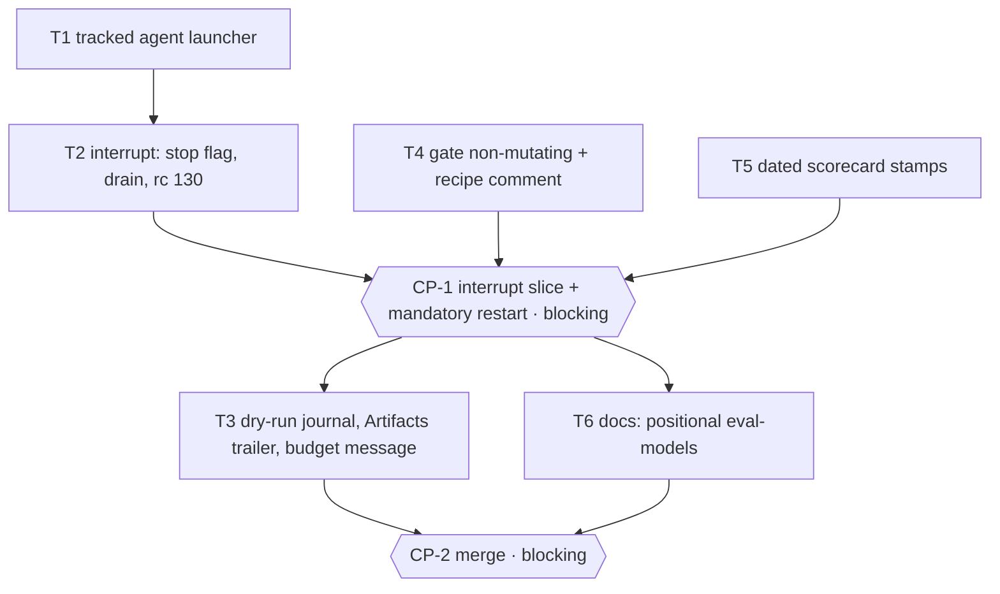

# Tasks — Lab fixes before iteration 3

> Run in kit mode under the kit's own policy (`squad`: ≤ 5 tasks between checkpoints). T2 changes
> the orchestrator's own signal handling: CP-1 restarts the engine before T3 so the rest runs on it.

## Coverage

| Spec ID | Tasks | Eval |
|---|---|---|
| BHV-1, BHV-1a, BHV-1b, INV-1 | T1 (tracked launcher), T2 (interrupt) | EVAL-1 |
| BHV-2, INV-2 | T3 | EVAL-2 |
| BHV-3, INV-3 | T3 | EVAL-3 |
| BHV-4, INV-4 | T4 | EVAL-4 |
| BHV-5 | T3 | EVAL-5 |
| BHV-6, INV-5 | T5 | EVAL-6 |
| BHV-7 | T4 (justfile comment), T6 (docs) | EVAL-7 |

ADRs: ADR-1 T1 · ADR-2 T2 · ADR-3 T3 · ADR-4 T3 · ADR-5 T4 · ADR-6 T3/T5 · ADR-7 T4/T6.

## Execution graph

Parallel waves: {T1, T4, T5} (disjoint: runner/sandbox · justfile · eval_models), then T2, then
{T3, T6} (orchestrate.py · docs).

## Tasks

### T1 — One tracked launcher for every agent process
- **agent:** implementer
- **depends_on:** —
- **parallel_group:** A *(∥ T4, T5 — disjoint paths)*
- **implements:** [BHV-1, INV-1]
- **anchored_on:** ADR-1, I-3, E-2
- **files_touched:** `lab/engine/runner.py`, `lab/engine/sandbox_runner.py`, `tests/lab_fixes/__init__.py`, `tests/lab_fixes/test_tracked_launch.py`, `tests/test_runner.py`, `tests/fde_kit/test_sandbox_external.py`
- **prompt:**
  > Per spec BHV-1 / INV-1 and design ADR-1. In `runner.py`, add `run_tracked(cmd, cwd, env,
  > timeout) -> (rc, stdout, stderr)`: `subprocess.Popen(..., start_new_session=True, text=True,
  > stdout/stderr=PIPE)`, registered in a module-level set (under a lock) while it runs, then
  > `communicate(timeout=timeout)`; on `TimeoutExpired` kill the whole process group (`os.killpg`)
  > and keep today's `"timeout: agent killed after {timeout}s"` result. Add `terminate_all(grace_s=5)`:
  > SIGTERM to every registered group, wait up to `grace_s`, then SIGKILL the survivors; returns the
  > number of groups signalled. `ClaudeCliRunner.run` and `SandboxedClaudeRunner.run` use
  > `run_tracked` instead of `subprocess.run` (sandbox: keep `--rm` on `docker run`). Do not touch
  > `orchestrate.py` (T2). Tests (not evals) in `tests/lab_fixes/test_tracked_launch.py` with a tiny
  > script that spawns a child and sleeps: `terminate_all` leaves no process of the group alive;
  > timeout still returns the timeout result; a normal run returns rc/stdout unchanged.
  > Create `tests/lab_fixes/__init__.py` (empty). *Plan delta (OQ-2, spec 0.2.0):* in
  > `tests/test_runner.py` and `tests/fde_kit/test_sandbox_external.py`, the stubs of
  > `sandbox_runner.subprocess.run` move to `sandbox_runner.run_tracked`, same argv assertions.
  > Check with `uv run pytest`; the orchestrator runs `verify`.
- **done_when:** both runners launch through `run_tracked`; `terminate_all` kills a group and its children; timeout behavior unchanged; runner tests green
- **verify:** `uv run pytest -q tests/lab_fixes/test_tracked_launch.py tests/test_runner.py tests/orchestrator`
- **status:** ☐ pending → ☐ running → ☐ done

### T4 — The local gate stops rewriting files
- **agent:** implementer
- **depends_on:** —
- **parallel_group:** A *(∥ T1, T5)*
- **implements:** [BHV-4, INV-4, BHV-7, EVAL-4]
- **anchored_on:** ADR-5, ADR-7, I-6
- **files_touched:** `justfile`, `tests/lab_fixes/test_eval_4_gate.py`, `tests/fde_kit/test_eval_8_examples.py`
- **prompt:**
  > Per spec BHV-4 / INV-4 and design ADR-5: `gate` depends on `lint-check` instead of `lint`
  > (`just lint` stays as the explicit fixer; say so in its comment). Per BHV-7 / ADR-7, fix the
  > `eval-models` recipe comment: parameters are positional (`just eval-models <layer> <live>
  > <models>`), never `key=value`. Test `tests/lab_fixes/test_eval_4_gate.py`
  > (`@pytest.mark.eval`, `test_eval_4_<case>`): parse `just --justfile justfile --dump --dump-format
  > json` (or the text) and assert `gate`'s dependencies include `lint-check` and not `lint`; on a
  > temp copy of a tiny project with a seeded format drift, the `gate`-style lint check fails and
  > `git status --porcelain` is unchanged. Do not run `just gate` on the kit itself.
  > *Plan delta (OQ-1, spec 0.2.0):* in `tests/fde_kit/test_eval_8_examples.py`, replace the closed
  > set asserted by `test_eval_8_kit_work_holds_only_sdlc_rework_and_fde_kit` with: none of
  > `devis-pose`, `export-devis`, `salle-booking` is tracked under the kit's `work/` (rename the test
  > accordingly, keep the `test_eval_8_` prefix).
  > Check with `uv run pytest`; the orchestrator runs `verify`.
- **done_when:** `gate` depends on `lint-check`; recipe comment positional; EVAL-4 green
- **verify:** `uv run pytest -q -m eval tests/lab_fixes/test_eval_4_gate.py`
- **status:** ☐ pending → ☐ running → ☐ done

### T5 — Campaign layers get dated stamps, never `latest`
- **agent:** implementer
- **depends_on:** —
- **parallel_group:** A *(∥ T1, T4)*
- **implements:** [BHV-6, INV-5, EVAL-6]
- **anchored_on:** ADR-6, I-7
- **files_touched:** `lab/engine/eval_models.py`, `tests/lab_fixes/test_eval_6_stamps.py`
- **prompt:**
  > Per spec BHV-6 / INV-5 and design ADR-6: without `--stamp`, `eval_models.py` writes its
  > scorecard as `<YYYY-MM-DD>-<layer>` (the `--layer` value, `all` included); if
  > `<stamp>.md` already exists in the scorecards dir, append `-2`, `-3`… until free. An explicit
  > `--stamp` is used as given. Tests with the model shim (`LAB_MODEL_SHIM=1`, temp `LAB_ROOT`),
  > `@pytest.mark.eval`, `test_eval_6_<case>`: EX-4 file names exact (inject the date); same layer
  > twice ⇒ `-2`; explicit `--stamp` honored. Never `--live`.
  > Check with `uv run pytest`; the orchestrator runs `verify`.
- **done_when:** EX-4 exact; collision suffix; explicit stamp honored; EVAL-6 green
- **verify:** `uv run pytest -q -m eval tests/lab_fixes/test_eval_6_stamps.py`
- **status:** ☐ pending → ☐ running → ☐ done

### T2 — Interrupt: stop flag, drain, no commit, rc 130
- **agent:** implementer
- **depends_on:** [T1]
- **parallel_group:** B
- **implements:** [BHV-1, BHV-1a, BHV-1b, INV-1, EVAL-1]
- **anchored_on:** ADR-2, E-1, E-3, E-4, I-1
- **files_touched:** `lab/engine/orchestrate.py`, `tests/lab_fixes/test_eval_1_interrupt.py`
- **prompt:**
  > Per spec BHV-1 (+1a, 1b) / INV-1 and design ADR-2. In a real run, `main()` installs SIGINT and
  > SIGTERM handlers that set a module `STOP` (`threading.Event`) and call `runner.terminate_all()`.
  > Workers check `STOP` before an agent turn, after it, and right before `scoped_commit`; when set
  > they return `"interrupted"` and never commit. The main loop then cancels queued futures
  > (`shutdown(cancel_futures=True)`), waits for the workers, writes every in-flight task as
  > `pending` (done ones stay done; atomic write), journals `{"event": "run_interrupted",
  > "inflight": [...], "signal": "SIGINT"|"SIGTERM"}`, prints how to resume, exits 130. A second
  > signal during shutdown exits at once (`os._exit(130)`). Checkpoint and Owner-lane waits return
  > on `STOP` (the CP stays pending). Tests with the shim sandbox, `@pytest.mark.eval`,
  > `test_eval_1_<case>`: start the orchestrator as a subprocess on a 2-task parallel wave whose shim
  > sleeps; once the journal shows the attempts, send SIGINT ⇒ EX-1 exactly (rc 130, 0 new commit,
  > no shim process left, state, `run_interrupted`); a second signal exits at once; an interrupt
  > while waiting at a blocking CP leaves it pending. Do not change `runner.py` (T1).
  > Check with `uv run pytest`; the orchestrator runs `verify`.
- **done_when:** EX-1 exact; second signal exits at once; checkpoint wait interruptible; EVAL-1 green; existing orchestrator suite green
- **verify:** `uv run pytest -q tests/lab_fixes/test_eval_1_interrupt.py tests/orchestrator`
- **status:** ☐ pending → ☐ running → ☐ done

### CP-1 — CHECKPOINT: interrupt slice + mandatory engine restart
- **trigger:** automatic when [T1, T2, T4, T5] are done
- **validator:** Owner
- **mode:** blocking — *the engine running this plan predates T2; the restart is a human action.*
- **reviews:** EVAL-1 / EVAL-4 / EVAL-6 modules; a live interrupt by hand (a real run on a scratch feature in a temp instance, Ctrl-C mid-task, then check rc 130, `state.json`, `run_interrupted`, and no stray `claude` process); `just gate` on a seeded drift leaves the tree unchanged; `just gate-ci` green.
- **self_hosting:** MANDATORY — stop the orchestrator (with T2's handler now in the code, a Ctrl-C is the test), restart it, then approve.
- **on_reject:** `lab/engine/reject.sh CP-1 work/lab-fixes "reason" [Tn …]`.

### T3 — Honest run record: dry run silent, trailers from the commit, budget source
- **agent:** implementer
- **depends_on:** [CP-1]
- **parallel_group:** C *(∥ T6 — disjoint paths)*
- **implements:** [BHV-2, INV-2, BHV-3, INV-3, BHV-5, EVAL-2, EVAL-3, EVAL-5]
- **anchored_on:** ADR-3, ADR-4, ADR-6, I-2, I-4, I-5
- **files_touched:** `lab/engine/orchestrate.py`, `tests/lab_fixes/test_eval_2_dry_run.py`, `tests/lab_fixes/test_eval_3_trailers.py`, `tests/lab_fixes/test_eval_5_budget.py`
- **prompt:**
  > Per spec BHV-2, BHV-3, BHV-5 / INV-2, INV-3 and design ADR-3, ADR-4, ADR-6. (1) `journal()` is a
  > no-op in a dry run (module flag set from `args.dry_run`, like `save()`'s guard). (2)
  > `_commit_message` no longer emits `Artifacts:`; `scoped_commit` stages as today, reads the
  > staged paths (`git diff --cached --name-only`), appends `Artifacts: <sorted staged paths>` and
  > commits — for task and Owner-lane commits alike. (3) The budget stop message names the cap's
  > source resolved at start: `LAB_BUDGET_USD` when set, else `budget_usd, <origin>` from the
  > effective policy — EX-3's message exactly. Tests with the shim sandbox, `@pytest.mark.eval`:
  > `test_eval_2_<case>` (`.runs/` byte-identical / absent around a dry run), `test_eval_3_<case>`
  > (task, Owner-lane and run-log-only commits: trailer = staged paths; EX-2), `test_eval_5_<case>`
  > (EX-3 exact; env var named when set). Do not touch the interrupt code (T2) beyond what these need.
  > Check with `uv run pytest`; the orchestrator runs `verify`.
- **done_when:** EVAL-2, EVAL-3, EVAL-5 green; orchestrator suite green
- **verify:** `uv run pytest -q tests/lab_fixes tests/orchestrator`
- **status:** ☐ pending → ☐ running → ☐ done

### T6 — Docs: `just eval-models` is positional everywhere
- **agent:** implementer
- **depends_on:** [CP-1]
- **parallel_group:** C *(∥ T3)*
- **implements:** [BHV-7, EVAL-7]
- **anchored_on:** ADR-7, I-8
- **files_touched:** `README.md`, `docs/how-to/evaluate-models.md`, `lab/models/EVOLUTION.md`, `tests/lab_fixes/test_eval_7_docs.py`
- **prompt:**
  > Per spec BHV-7 and design ADR-7: every `just eval-models` invocation in `README.md`,
  > `docs/how-to/evaluate-models.md` and `lab/models/EVOLUTION.md` uses positional parameters
  > (`just eval-models <layer> <live> <models>`, e.g. `just eval-models all 1`,
  > `just eval-models chain 1 claude-opus-4-8,claude-haiku-4-5-20251001`). Change only those
  > command lines — no other edit to EVOLUTION.md (it is scaffolding). Test
  > `tests/lab_fixes/test_eval_7_docs.py` (`@pytest.mark.eval`, `test_eval_7_<case>`): scan
  > README.md, docs/**, lab/models/EVOLUTION.md and the `justfile` comments for `eval-models`
  > followed by a `key=value` token ⇒ none. Only these files: do not fix the syntax elsewhere.
  > Check with `uv run pytest`; the orchestrator runs `verify`.
- **done_when:** no `key=value` eval-models invocation left in the scanned files; EVAL-7 green
- **verify:** `uv run pytest -q -m eval tests/lab_fixes/test_eval_7_docs.py`
- **status:** ☐ pending → ☐ running → ☐ done

### CP-2 — CHECKPOINT: merge (human, final)
- **trigger:** automatic when [T1, T2, T3, T4, T5, T6] are done
- **validator:** Owner (PR review)
- **mode:** blocking — *the merge is always human.*
- **reviewers:** 2
- **reviews:** full diff vs main; `just gate-ci` green; EVAL-1..7 green; `just check-content work/lab-fixes`; `just check-trajectory work/lab-fixes` (its journal must show no dry-run noise from now on).
- **on_reject:** `lab/engine/reject.sh CP-2 work/lab-fixes "reason" [Tn …]`.

## Run log

| Date | Task | Agent | Result | Commit |
|---|---|---|---|---|
| 2026-11-13 10:17 | T1 | implementer | BLOCKED — OQ-2 | |
| 2026-11-13 10:17 | T4 | implementer | BLOCKED — OQ-1 | |
| 2026-11-13 10:17 | T5 | eval-runner | FAIL (t1) | |
| 2026-11-13 10:18 | T5 | implementer | BLOCKED — OQ-1 | |
| 2026-11-13 10:44 | T4 | implementer | done, evals green (t1) | |
| 2026-11-13 10:44 | T5 | implementer | done, evals green (t1) | |
| 2026-11-13 10:45 | T1 | implementer | done, evals green (t1) | |
| 2026-11-13 10:51 | T2 | implementer | done, evals green (t1) | |
